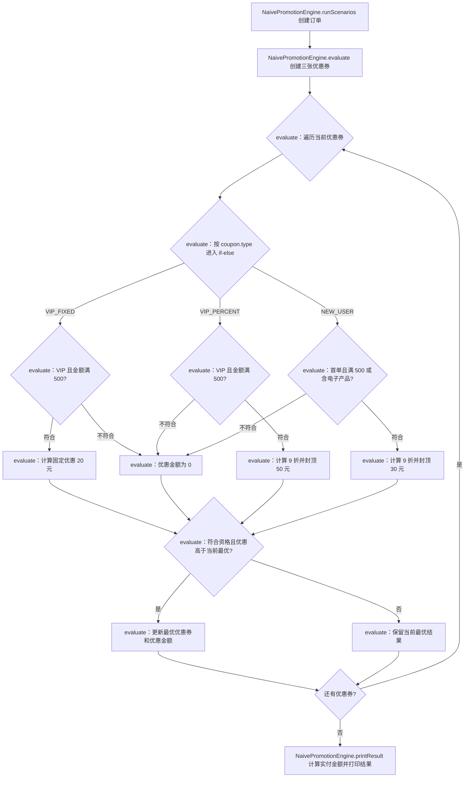
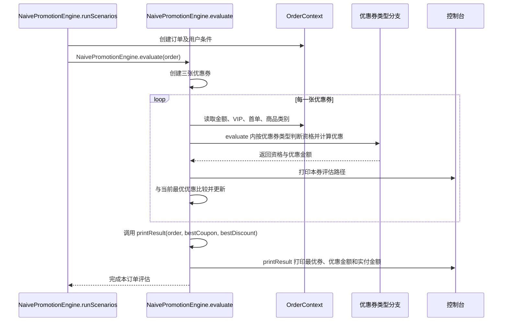

# v1-naive：代码流程图与时序图

本版本以单个 `NaivePromotionEngine.evaluate` 方法串联活动资格判断、优惠金额计算和互斥优惠券择优，作为模式重构前的对照基线。

## 代码流程图

## 代码时序图

## 阅读提示

- 同一类型分支既知道活动资格，也知道优惠算法；新增活动容易继续扩大分支。
- 优惠券互斥并择优是引擎中的显式业务流程，不是某个计算分支自动提供的能力。
- v2 将规则解释、表达式结构复用、优惠算法分别拆开，便于对照职责变化。
