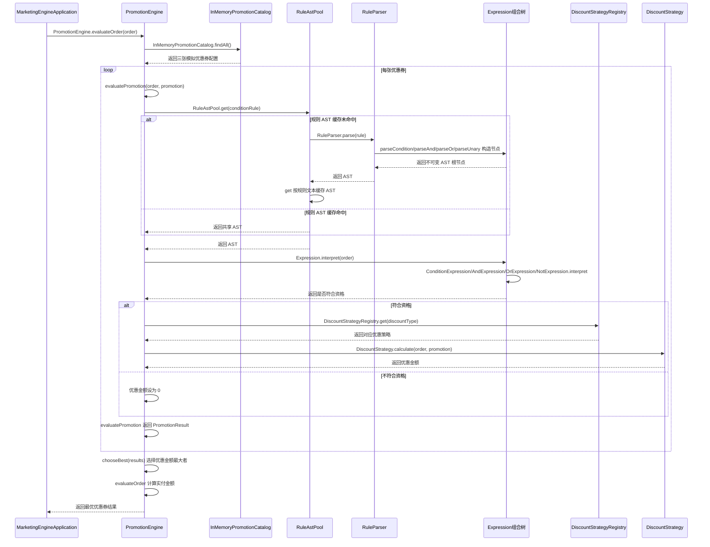

# v2-pattern：代码流程图与时序图

本版本在同一订单评估链路中协作使用解释器、组合、享元和策略：解释器执行规则，组合节点表达规则树，享元池复用不可变规则树，策略计算优惠金额。

## 代码流程图

```mermaid
flowchart TD
    A[MarketingEngineApplication.runScenarios 装配依赖] --> B[runScenarios 创建 OrderContext]
    B --> C[PromotionEngine.evaluateOrder]
    C --> D[InMemoryPromotionCatalog.findAll 读取模拟活动]
    D --> E{逐张评估优惠券}
    E --> F[PromotionEngine.evaluatePromotion 调用 RuleAstPool.get(rule)]
    F --> G{RuleAstPool.get：缓存中是否已有 AST?}
    G -->|命中| H[RuleAstPool.get：复用不可变 Expression AST]
    G -->|未命中| I[RuleParser.parse：按 NOT/AND/OR 优先级解析 DSL]
    I --> J[RuleParser.parseUnary/parseAnd/parseOr：创建组合节点]
    J --> K[RuleAstPool.get：缓存 AST 并返回]
    H --> L[Expression.interpret(order)：解释当前订单上下文]
    K --> L
    L --> M{PromotionEngine.evaluatePromotion：活动资格成立?}
    M -->|否| N[evaluatePromotion：优惠金额设为 0]
    M -->|是| O[DiscountStrategyRegistry.get：按 DiscountType 取策略]
    O --> P{优惠类型}
    P -->|FIXED| Q[FixedDiscountStrategy.calculate 计算固定立减]
    P -->|PERCENTAGE| R[PercentageDiscountStrategy.calculate 计算比例并封顶]
    Q --> S[PromotionEngine.evaluatePromotion 创建 PromotionResult]
    R --> S
    N --> S
    S --> T{PromotionEngine.evaluateOrder：还有活动?}
    T -->|是| E
    T -->|否| U[PromotionEngine.chooseBest 选择优惠最大的互斥券]
    U --> V[evaluateOrder 计算实付金额并输出结果]
```

## 代码时序图



## 阅读提示

- `RuleParser` 负责把字符串转换成 AST；`Expression.interpret` 负责执行规则，两者不是同一职责。
- AND、OR、NOT 节点与条件叶子共用 `Expression` 接口，构成组合结构。
- `RuleAstPool` 只共享规则结构；每次解释时传入订单上下文，AST 不保存订单状态。
- 策略只计算单张券的优惠金额；是否符合条件由规则 AST 判断，互斥券择优由 `PromotionEngine` 完成。
