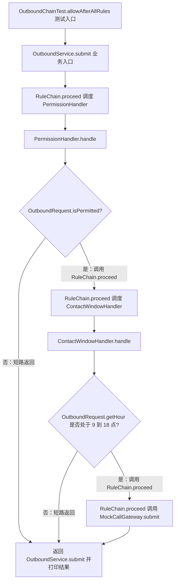
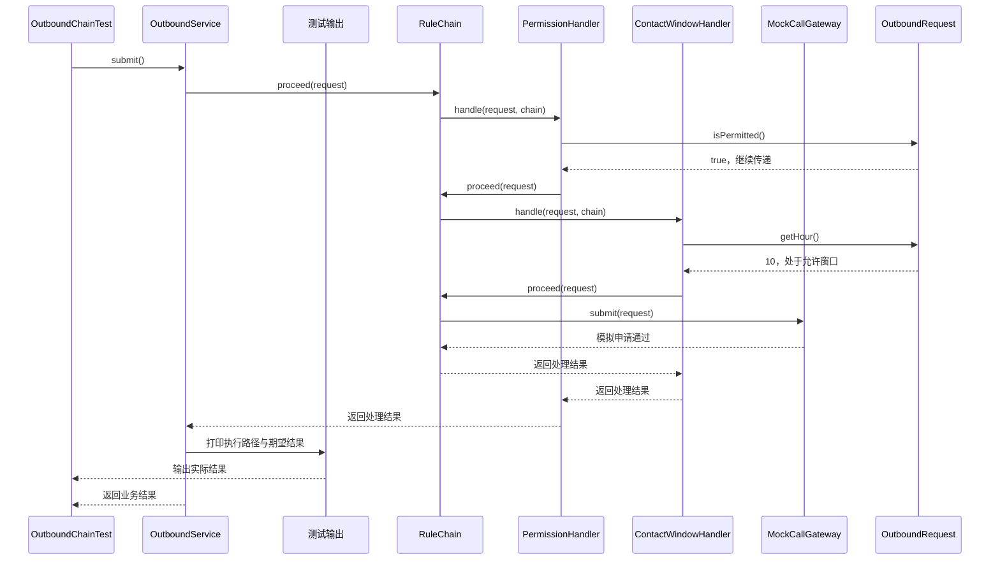

# 责任链模式：v3-pattern 流程图与时序图

本图对应版本说明：RuleHandler + 请求专用 RuleChain；节点决定是否传递，服务只启动链，不认识具体规则。

## 代码流程图

## 代码时序图

## 阅读提示

- 先从 `OutboundChainTest.allowAfterAllRules()` 进入，再沿图中的真实类名和方法名阅读源码。
- 本版本的模式关注点：责任链让请求依次经过处理节点，由节点决定继续传递或短路。
- 条件分支与返回细节请结合图中方法源码和同目录测试用例观察。
