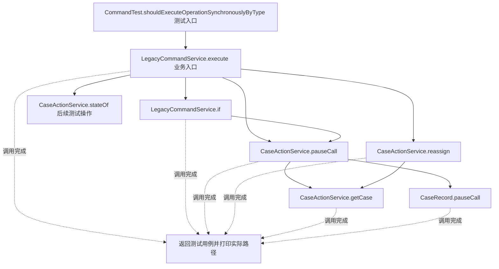
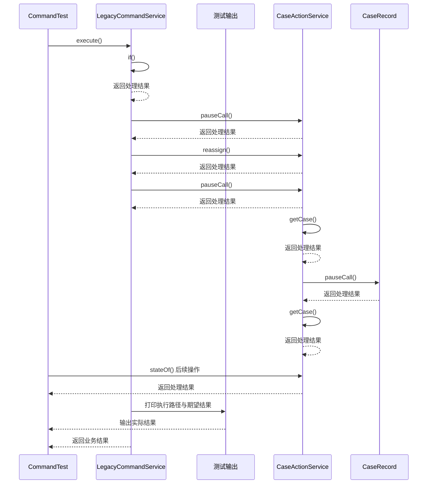

# 命令模式：v1-naive 流程图与时序图

本图对应版本说明：通过字符串类型分支，同步调用暂停外呼或重新分案；操作分支、参数解释与业务调用集中，不能自然排队或延迟执行。

## 代码流程图

## 代码时序图

## 阅读提示

- 先从 `CommandTest.shouldExecuteOperationSynchronouslyByType()` 进入，再沿图中的真实类名和方法名阅读源码。
- 本版本的模式关注点：命令将操作请求封装为对象，使提交者与具体执行过程解耦。
- 条件分支与返回细节请结合图中方法源码和同目录测试用例观察。
