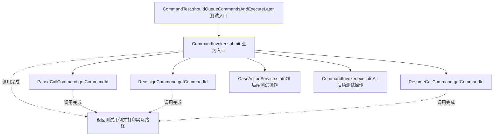
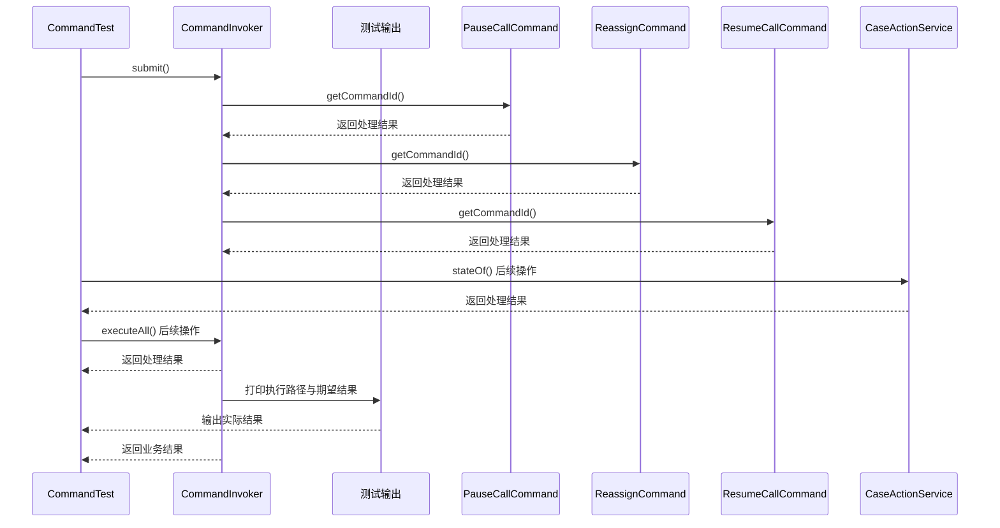

# 命令模式：v2-pattern 流程图与时序图

本图对应版本说明：PauseCallCommand`、`ReassignCommand` 实现统一接口，由 `CommandInvoker` 排队后触发；调用者与操作实现解耦；命令对象持有 Receiver，适合同进程经典模式。

## 代码流程图

## 代码时序图

## 阅读提示

- 先从 `CommandTest.shouldQueueCommandsAndExecuteLater()` 进入，再沿图中的真实类名和方法名阅读源码。
- 本版本的模式关注点：命令将操作请求封装为对象，使提交者与具体执行过程解耦。
- 条件分支与返回细节请结合图中方法源码和同目录测试用例观察。
