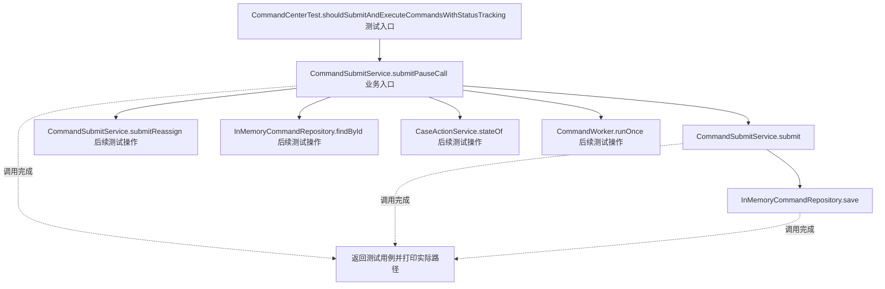
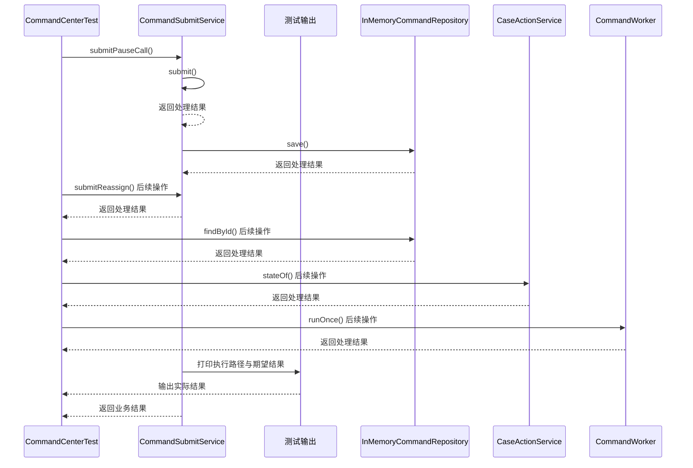

# 命令模式：v3-production 流程图与时序图

本图对应版本说明：保存数据型 `OperationCommand`，Worker 认领后按类型派发给 Handler；模拟 HTTP 提交与后台执行分离，并记录 PENDING/RUNNING/SUCCESS/FAILED 状态。

## 代码流程图

## 代码时序图

## 阅读提示

- 先从 `CommandCenterTest.shouldSubmitAndExecuteCommandsWithStatusTracking()` 进入，再沿图中的真实类名和方法名阅读源码。
- 本版本的模式关注点：命令将操作请求封装为对象，使提交者与具体执行过程解耦。
- 条件分支与返回细节请结合图中方法源码和同目录测试用例观察。
