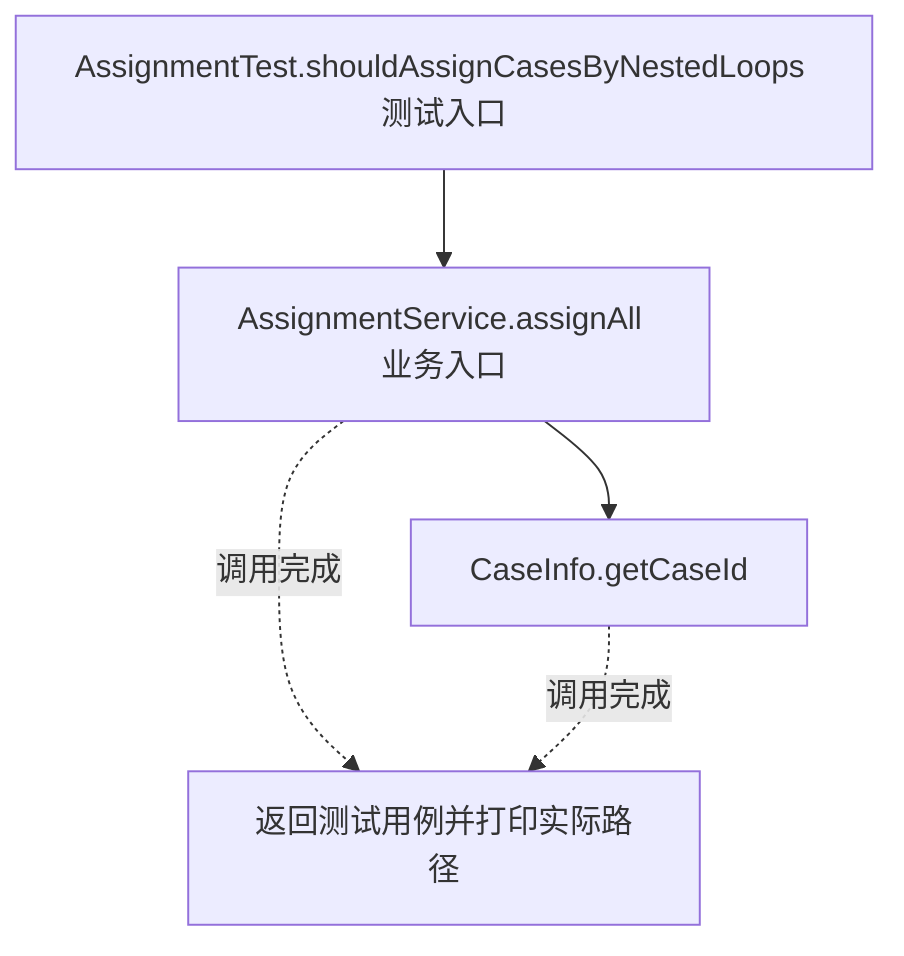
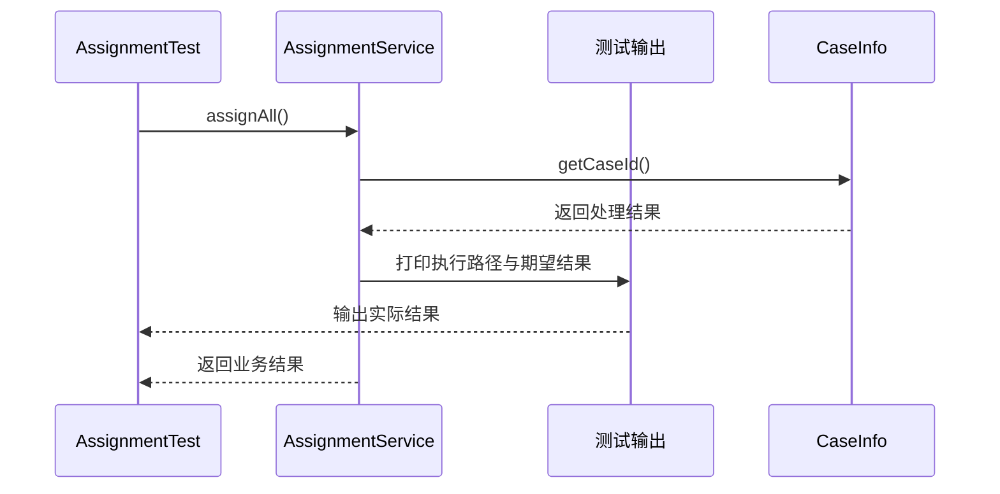

# 迭代器模式：v1-naive 流程图与时序图

本图对应版本说明：AssignmentService` 使用两层下标循环访问 `List<List<CaseInfo>>；空组可被自然处理，但业务服务了解分组结构，存储结构变化会影响遍历代码。

## 代码流程图

## 代码时序图

## 阅读提示

- 先从 `AssignmentTest.shouldAssignCasesByNestedLoops()` 进入，再沿图中的真实类名和方法名阅读源码。
- 本版本的模式关注点：迭代器封装集合遍历状态，使调用者无需了解集合内部组织。
- 条件分支与返回细节请结合图中方法源码和同目录测试用例观察。
