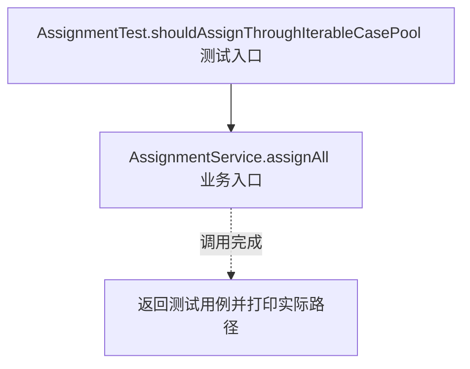
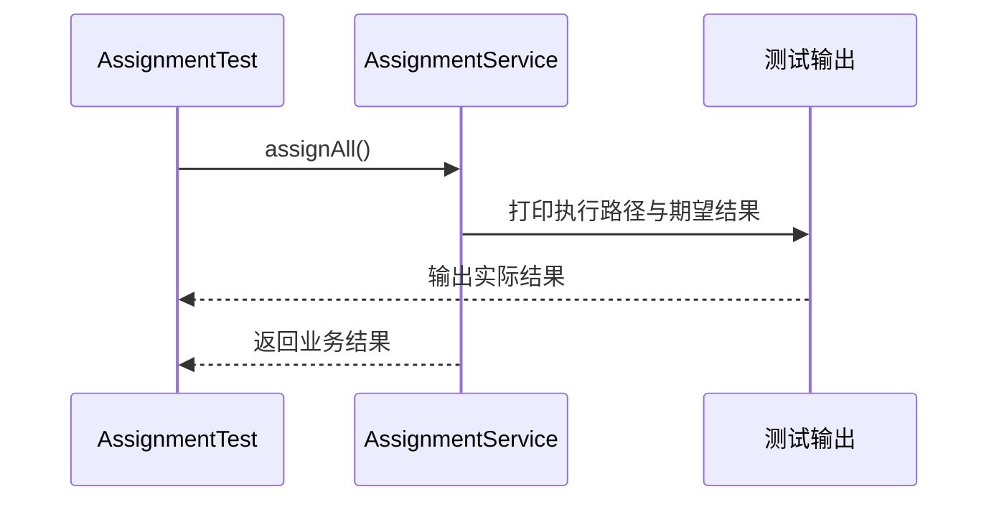

# 迭代器模式：v2-refactor 流程图与时序图

本图对应版本说明：提取 `CasePool extends Iterable<CaseInfo>`；分组池先展平为只读列表，再使用 JDK 的 `Iterator；分案服务只依赖 `Iterable`；展平复制占用额外内存，也尚未展示自定义遍历状态。

## 代码流程图

## 代码时序图

## 阅读提示

- 先从 `AssignmentTest.shouldAssignThroughIterableCasePool()` 进入，再沿图中的真实类名和方法名阅读源码。
- 本版本的模式关注点：迭代器封装集合遍历状态，使调用者无需了解集合内部组织。
- 条件分支与返回细节请结合图中方法源码和同目录测试用例观察。
