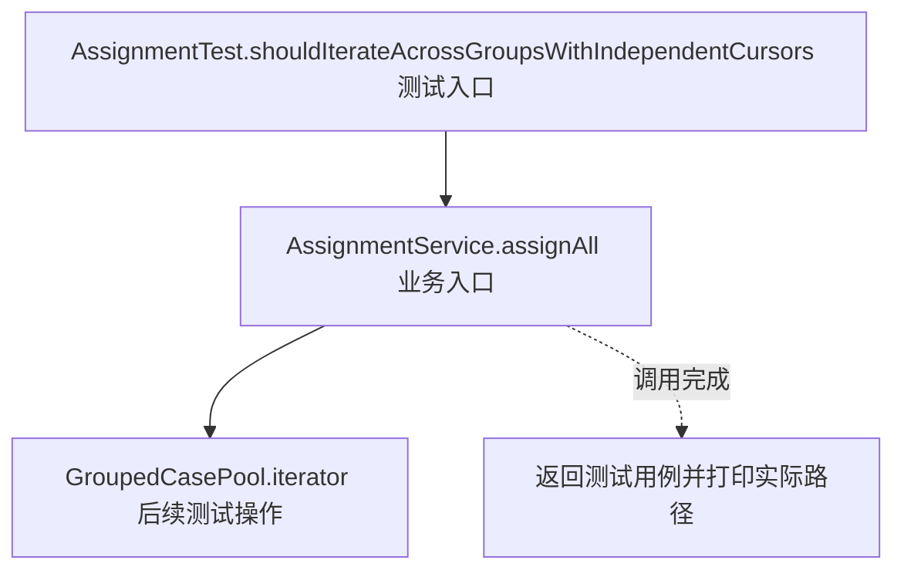
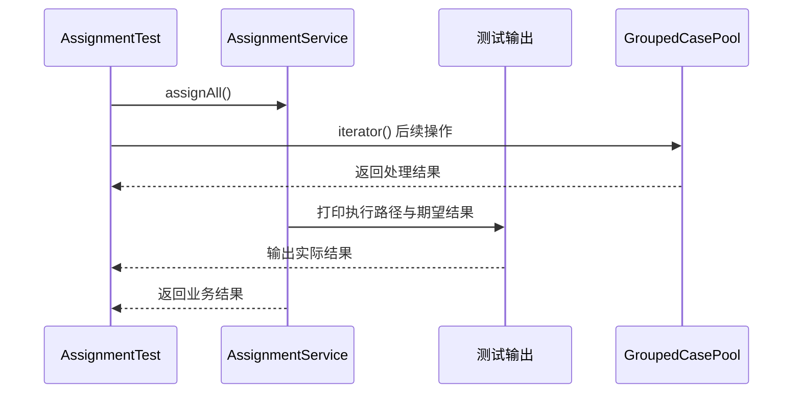

# 迭代器模式：v3-pattern 流程图与时序图

本图对应版本说明：保留分组快照，由 `GroupedCaseIterator` 用 `groupIndex`、`caseIndex` 跨组遍历；遍历游标属于每个迭代器，空组由迭代器跳过，调用方不需要了解内部结构；不支持删除。

## 代码流程图

## 代码时序图

## 阅读提示

- 先从 `AssignmentTest.shouldIterateAcrossGroupsWithIndependentCursors()` 进入，再沿图中的真实类名和方法名阅读源码。
- 本版本的模式关注点：迭代器封装集合遍历状态，使调用者无需了解集合内部组织。
- 条件分支与返回细节请结合图中方法源码和同目录测试用例观察。
