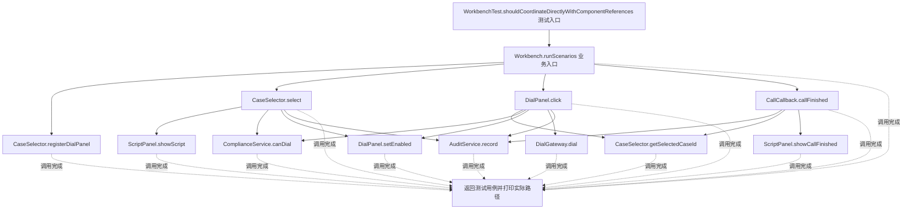
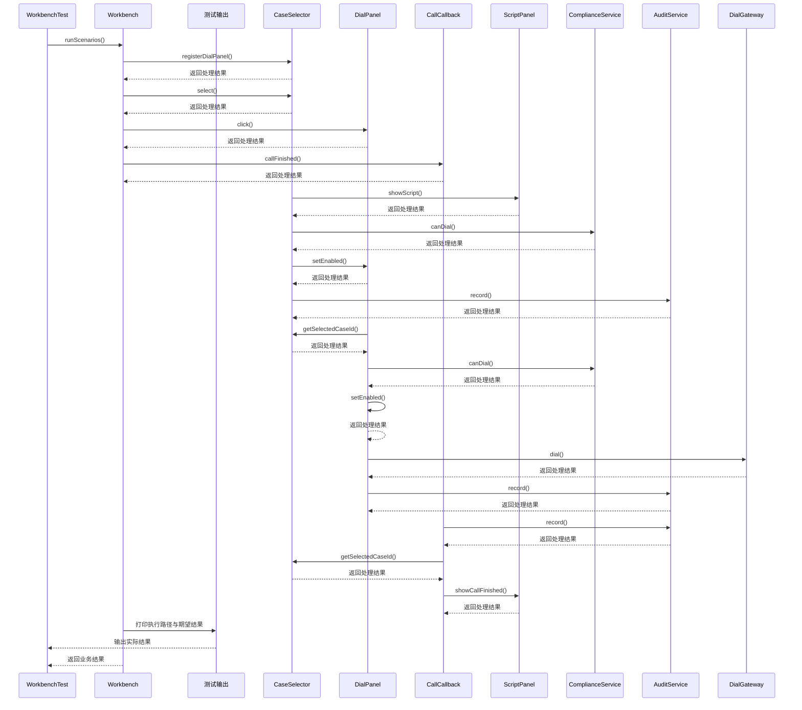

# 中介者模式：v1-naive 流程图与时序图

本图对应版本说明：CaseSelector` 直接调用话术、合规、外呼面板和审计；外呼面板及通话回调也直接持有其他组件；组件承担协调职责，逐渐形成网状依赖；新增面板时多个协作对象都可能变化。

## 代码流程图

## 代码时序图

## 阅读提示

- 先从 `WorkbenchTest.shouldCoordinateDirectlyWithComponentReferences()` 进入，再沿图中的真实类名和方法名阅读源码。
- 本版本的模式关注点：中介者集中协调多个组件的交互，减少组件间的网状依赖。
- 条件分支与返回细节请结合图中方法源码和同目录测试用例观察。
