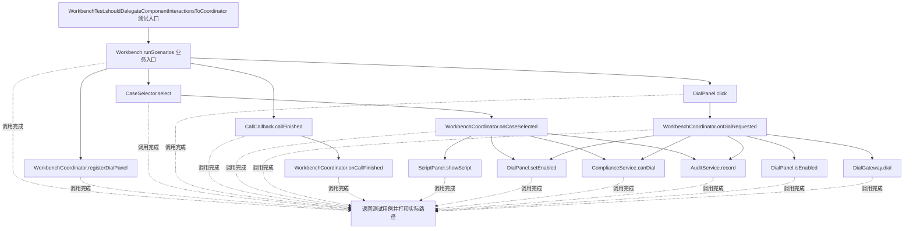
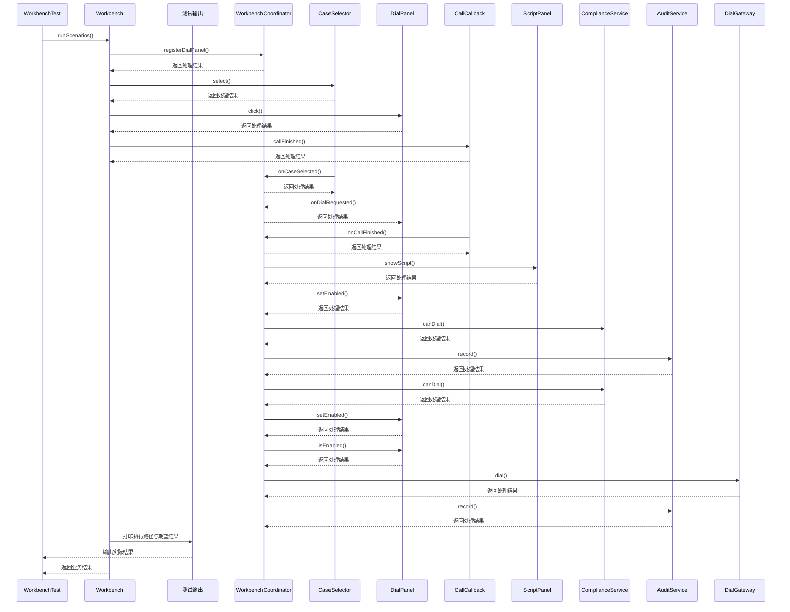

# 中介者模式：v2-refactor 流程图与时序图

本图对应版本说明：将协作流程移到 `WorkbenchCoordinator`，组件向具体协调者报告事件；协调职责集中，组件不再相互调用；组件仍依赖具体协调类，扩展替换边界不明确。

## 代码流程图

## 代码时序图

## 阅读提示

- 先从 `WorkbenchTest.shouldDelegateComponentInteractionsToCoordinator()` 进入，再沿图中的真实类名和方法名阅读源码。
- 本版本的模式关注点：中介者集中协调多个组件的交互，减少组件间的网状依赖。
- 条件分支与返回细节请结合图中方法源码和同目录测试用例观察。
