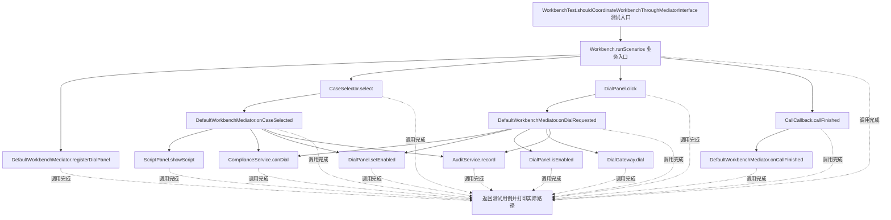
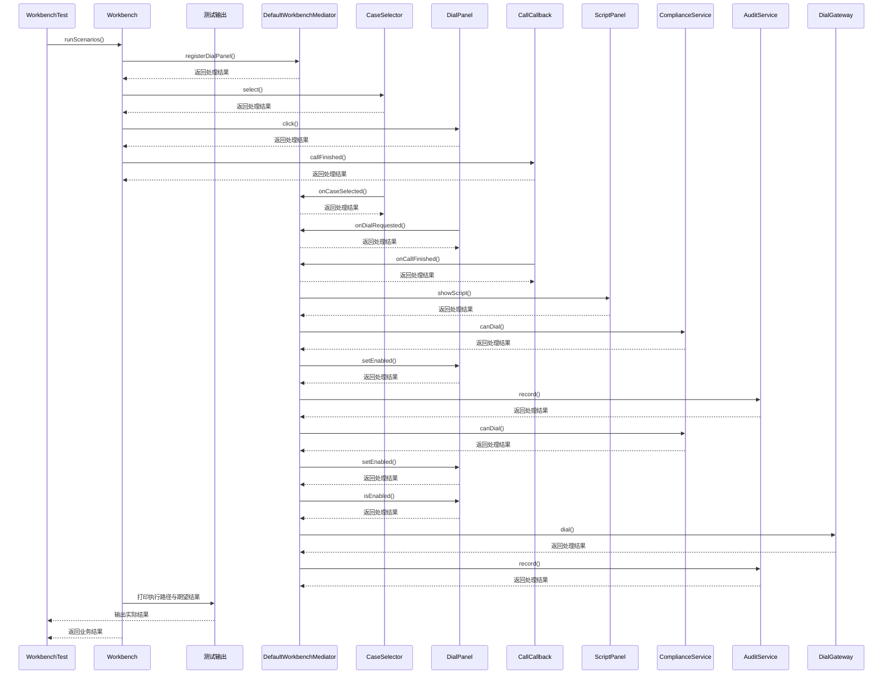

# 中介者模式：v3-pattern 流程图与时序图

本图对应版本说明：定义 `WorkbenchMediator` 协议，`CaseSelector`、`DialPanel`、`CallCallback` 只依赖该接口，由 `DefaultWorkbenchMediator` 决定协作流程；Colleague 与 ConcreteMediator 的角色清楚，组件直接依赖减少；协作复杂度仍集中在中介者，需按工作台或业务边界拆分。

## 代码流程图

## 代码时序图

## 阅读提示

- 先从 `WorkbenchTest.shouldCoordinateWorkbenchThroughMediatorInterface()` 进入，再沿图中的真实类名和方法名阅读源码。
- 本版本的模式关注点：中介者集中协调多个组件的交互，减少组件间的网状依赖。
- 条件分支与返回细节请结合图中方法源码和同目录测试用例观察。
