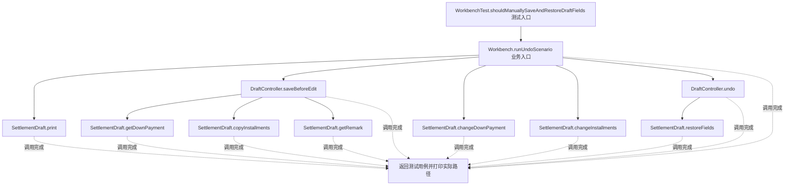
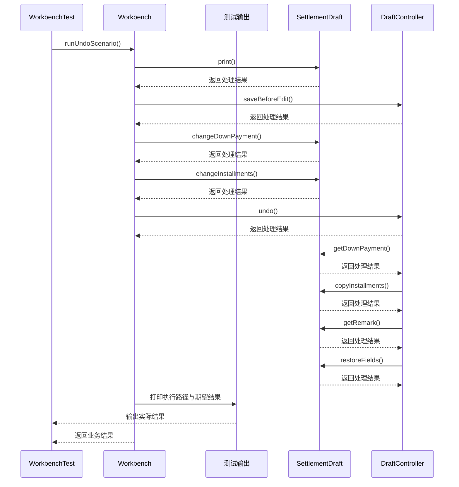

# 备忘录模式：v1-naive 流程图与时序图

本图对应版本说明：Controller 逐项读取首付、分期、备注，建立字段备份并逐项恢复；草稿字段增加时，外部 Controller 需要同步维护历史字段，容易漏保存或漏恢复。

## 代码流程图

## 代码时序图

## 阅读提示

- 先从 `WorkbenchTest.shouldManuallySaveAndRestoreDraftFields()` 进入，再沿图中的真实类名和方法名阅读源码。
- 本版本的模式关注点：备忘录保存对象状态快照并支持恢复，同时限制外部访问状态细节。
- 条件分支与返回细节请结合图中方法源码和同目录测试用例观察。
