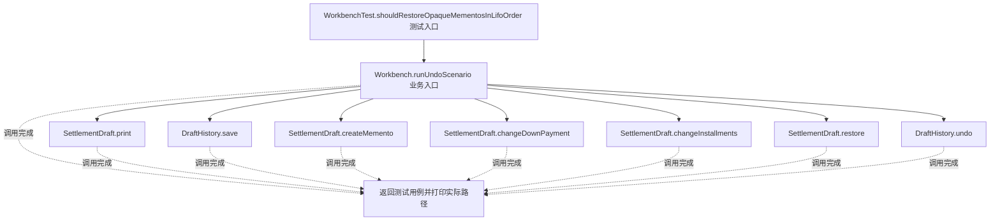
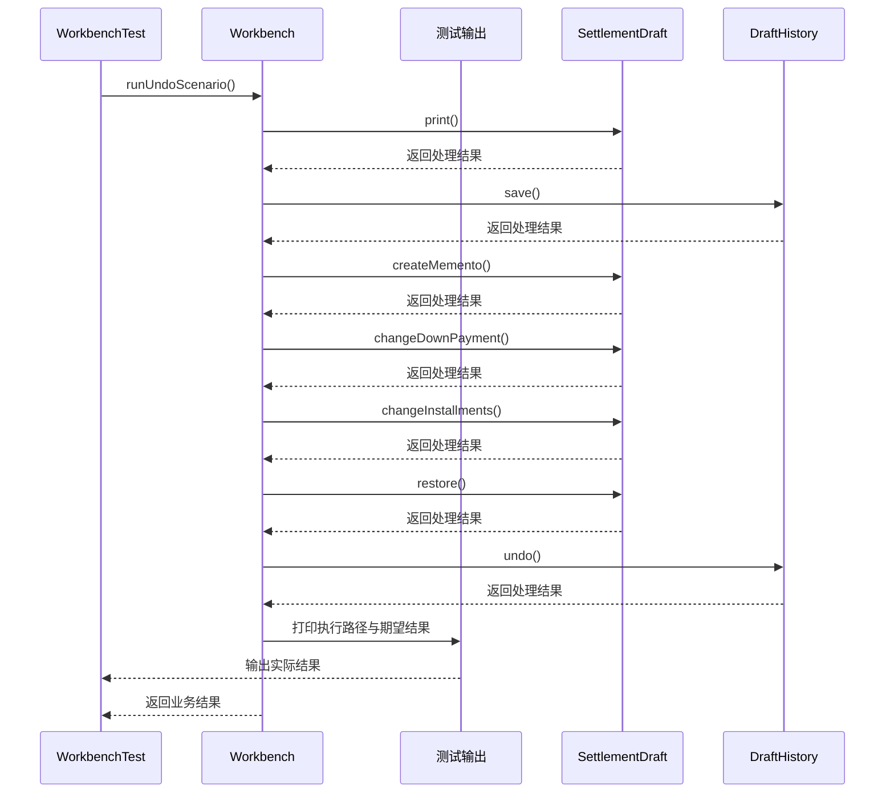

# 备忘录模式：v3-pattern 流程图与时序图

本图对应版本说明：SettlementDraft` 创建不可变且不暴露字段的 `Memento`；`DraftHistory` 只保存/弹出；完整展示 Originator、Memento、Caretaker 三个角色，以及两次撤销、空历史异常和集合防御性复制。

## 代码流程图

## 代码时序图

## 阅读提示

- 先从 `WorkbenchTest.shouldRestoreOpaqueMementosInLifoOrder()` 进入，再沿图中的真实类名和方法名阅读源码。
- 本版本的模式关注点：备忘录保存对象状态快照并支持恢复，同时限制外部访问状态细节。
- 条件分支与返回细节请结合图中方法源码和同目录测试用例观察。
