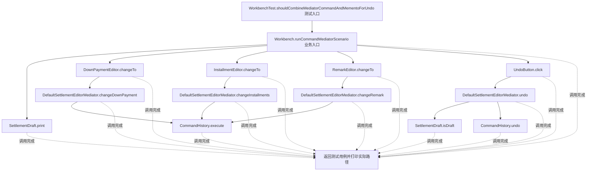
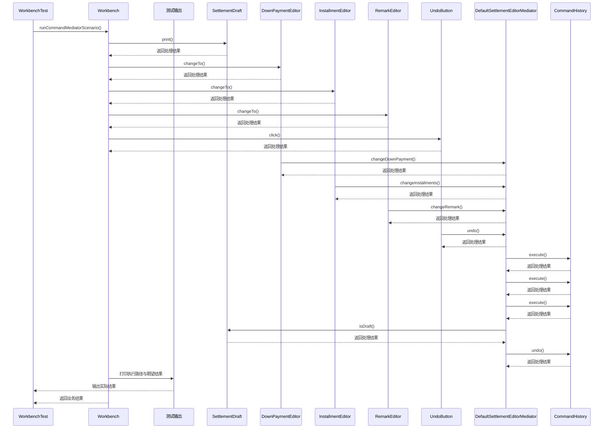

# 备忘录模式：v4-pattern-combination 流程图与时序图

本图对应版本说明：编辑工作台由 Mediator 协调 UI；Command 封装首付/分期/备注编辑；每条 Command 使用 Memento 撤销；业务状态限制审批后的编辑；展示 Command 负责操作、Memento 负责历史状态、Mediator 负责组件协作、状态规则负责可编辑边界；另以内存存储模拟版本历史取舍。

## 代码流程图

## 代码时序图

## 阅读提示

- 先从 `WorkbenchTest.shouldCombineMediatorCommandAndMementoForUndo()` 进入，再沿图中的真实类名和方法名阅读源码。
- 本版本的模式关注点：备忘录保存对象状态快照并支持恢复，同时限制外部访问状态细节。
- 条件分支与返回细节请结合图中方法源码和同目录测试用例观察。
