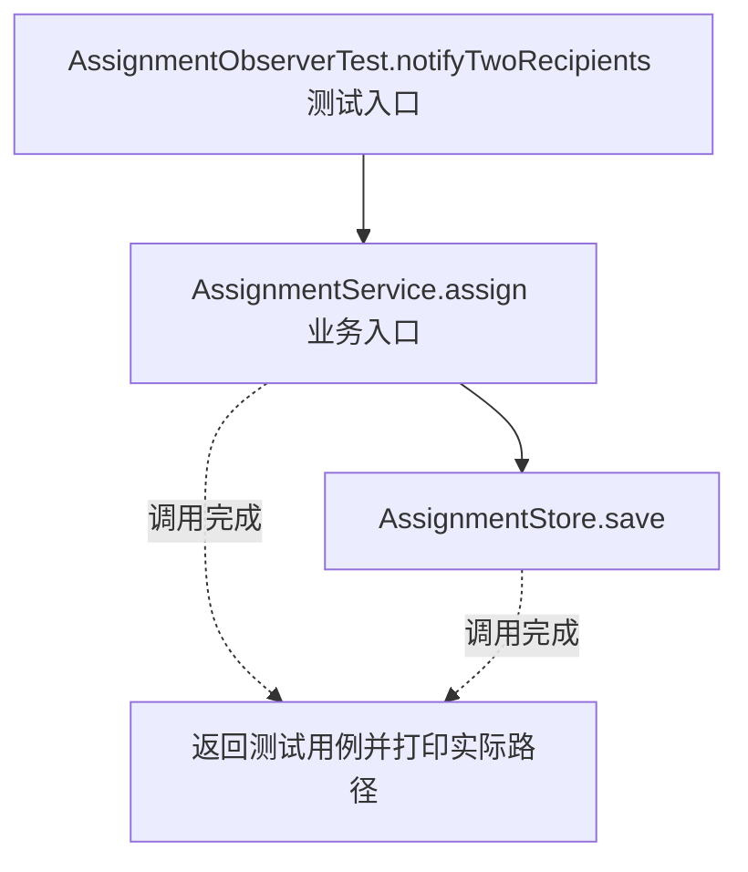
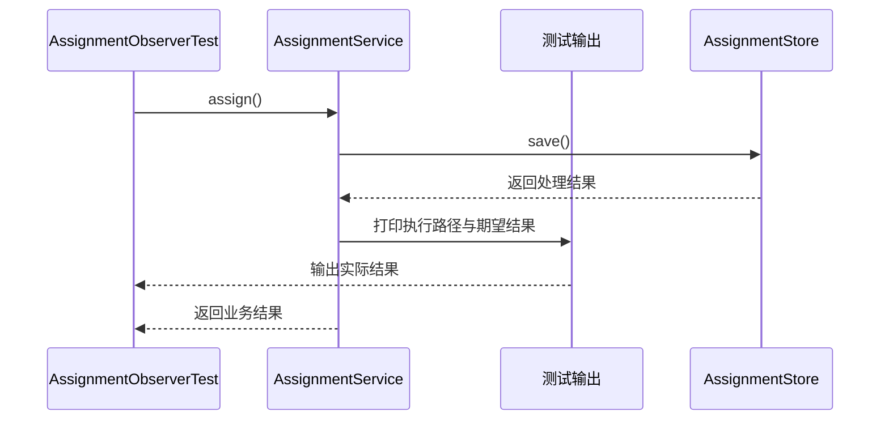

# 观察者模式：v4-spring-event 流程图与时序图

本图对应版本说明：ApplicationEventPublisher 与 @EventListener；容器管理事件分发和监听方法注册。

## 代码流程图

## 代码时序图

## 阅读提示

- 先从 `AssignmentObserverTest.notifyTwoRecipients()` 进入，再沿图中的真实类名和方法名阅读源码。
- 本版本的模式关注点：观察者通过订阅关系将一个事件发布给多个独立接收者。
- 条件分支与返回细节请结合图中方法源码和同目录测试用例观察。
