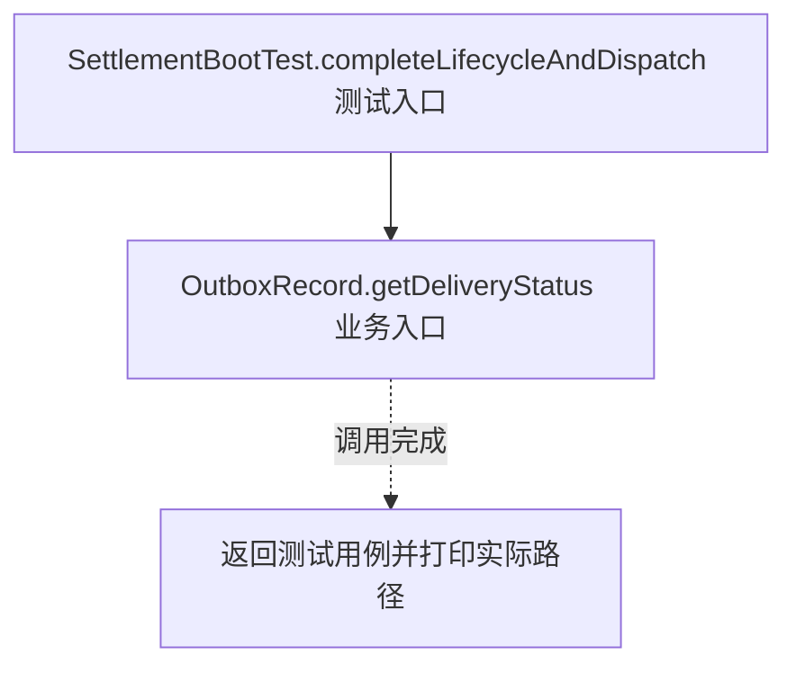
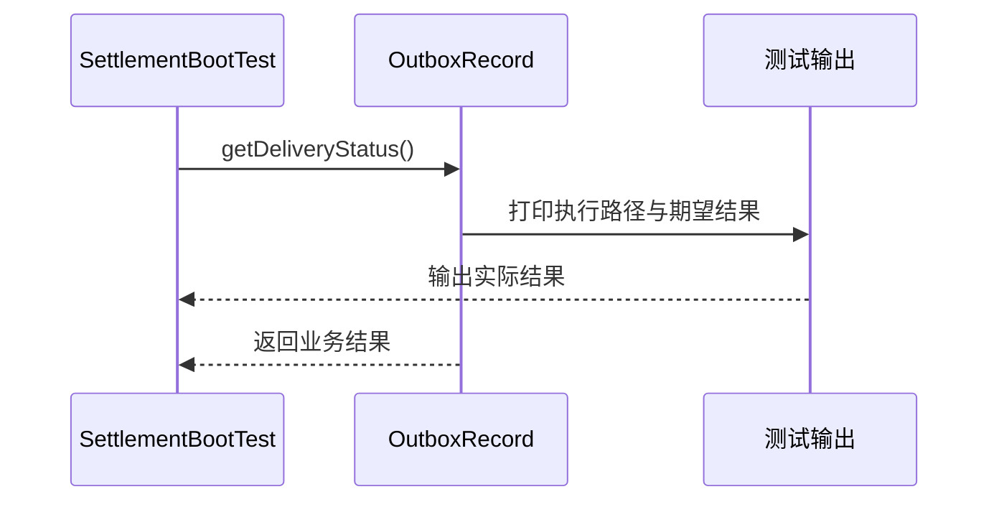

# 状态模式：v4-spring-boot 流程图与时序图

本图对应版本说明：Boot + MVC + MyBatis + H2 + 事务 Outbox；通过真实 HTTP 调度、事务代理与 SQL 落地迁移。

## 代码流程图

## 代码时序图

## 阅读提示

- 先从 `SettlementBootTest.completeLifecycleAndDispatch()` 进入，再沿图中的真实类名和方法名阅读源码。
- 本版本的模式关注点：状态模式把状态相关行为分配给状态对象，由当前状态决定事件响应。
- 条件分支与返回细节请结合图中方法源码和同目录测试用例观察。
