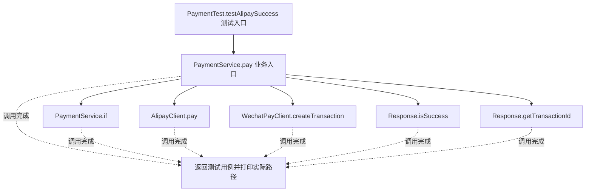
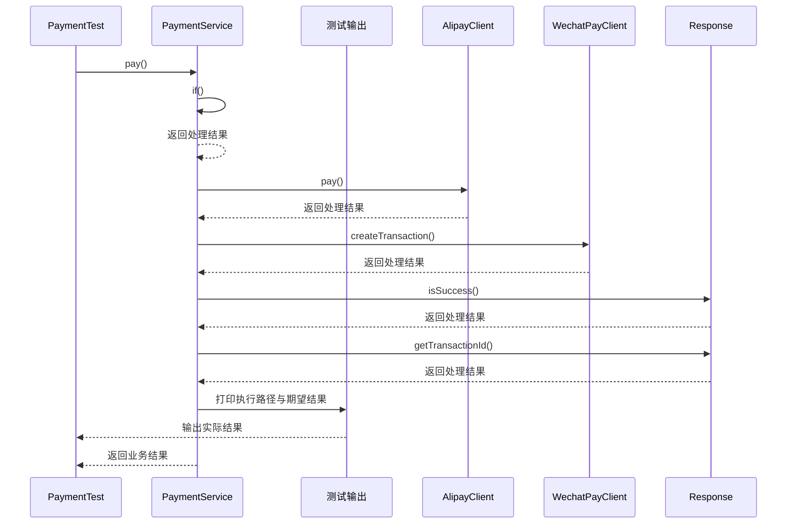

# 策略模式：v1-naive 流程图与时序图

本图对应版本说明：PaymentService 内直接分支、调用网关、转换响应；新增渠道或协议变更均修改核心服务。

## 代码流程图

## 代码时序图

## 阅读提示

- 先从 `PaymentTest.testAlipaySuccess()` 进入，再沿图中的真实类名和方法名阅读源码。
- 本版本的模式关注点：策略将可替换算法封装为统一接口，并由装配或注册机制选择。
- 条件分支与返回细节请结合图中方法源码和同目录测试用例观察。
