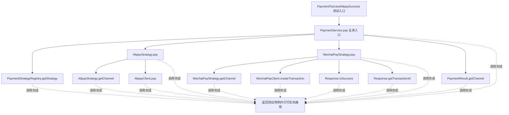
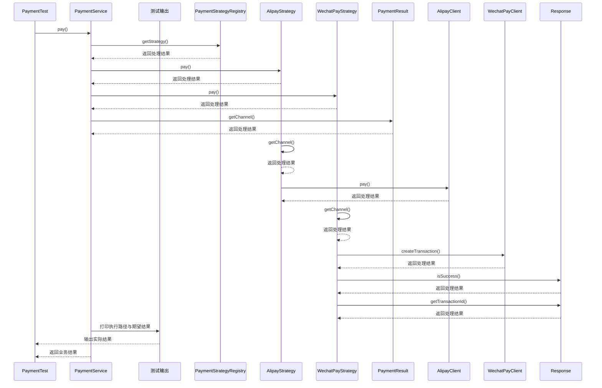

# 策略模式：v3-pattern 流程图与时序图

本图对应版本说明：PaymentStrategy + PaymentStrategyRegistry + PaymentService；创建在装配端、选择在注册表、执行在具体策略。

## 代码流程图

## 代码时序图

## 阅读提示

- 先从 `PaymentTest.testAlipaySuccess()` 进入，再沿图中的真实类名和方法名阅读源码。
- 本版本的模式关注点：策略将可替换算法封装为统一接口，并由装配或注册机制选择。
- 条件分支与返回细节请结合图中方法源码和同目录测试用例观察。
