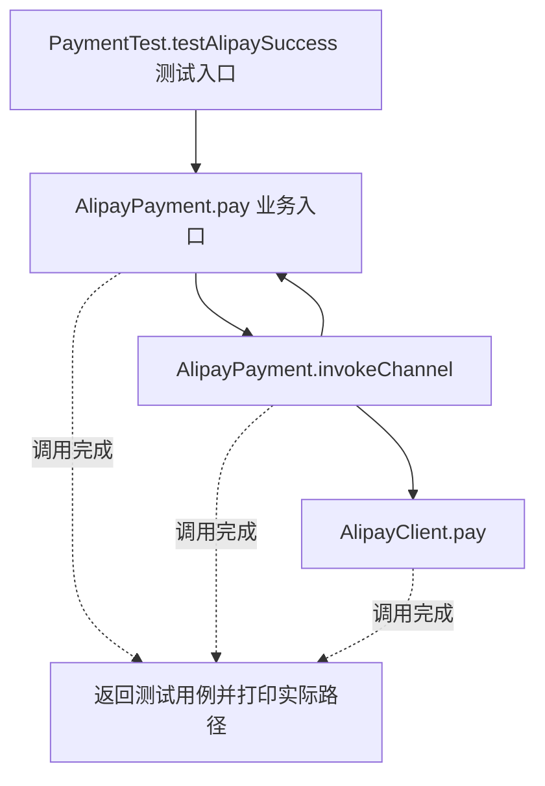
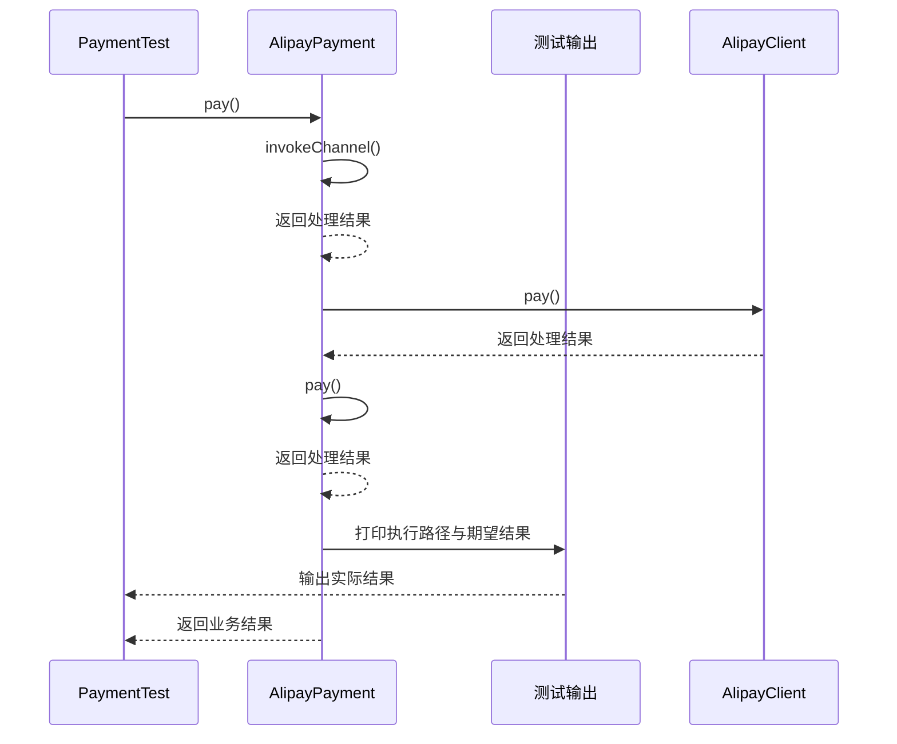

# 模板方法模式：v1-naive 流程图与时序图

本图对应版本说明：支付宝和微信各自复制校验、调用、成功、失败、完成流程；service/AlipayPayment、WechatPayment。

## 代码流程图

## 代码时序图

## 阅读提示

- 先从 `PaymentTest.testAlipaySuccess()` 进入，再沿图中的真实类名和方法名阅读源码。
- 本版本的模式关注点：模板方法固定算法骨架，并将可变步骤交给子类实现。
- 条件分支与返回细节请结合图中方法源码和同目录测试用例观察。
