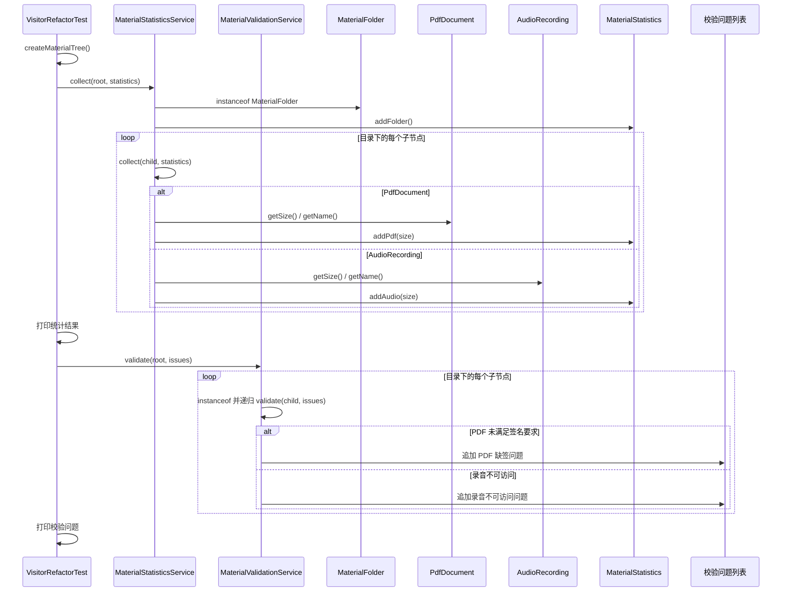

# v2-refactor：独立 Service 与类型分支

## 代码流程图

```mermaid
flowchart TD
    A[VisitorRefactorTest.shouldRunSeparateServicesWithTypeBranches] --> B[createMaterialTree 构建目录树]
    B --> C[MaterialStatisticsService.collect(root, statistics)]
    C --> D{node instanceof MaterialFolder}
    D -->|是| E[addFolder 并递归 collect(child, statistics)]
    E --> C
    D -->|否| F{node instanceof PdfDocument}
    F -->|是| G[MaterialStatistics.addPdf]
    F -->|否| H{node instanceof AudioRecording}
    H -->|是| I[MaterialStatistics.addAudio]
    H -->|否| X[抛出不支持的节点类型异常]
    G --> J[测试打印统计结果]
    I --> J
    J --> K[MaterialValidationService.validate(root, issues)]
    K --> L{按 MaterialFolder/PdfDocument/AudioRecording 分支}
    L -->|目录| M[递归 validate 子节点]
    M --> K
    L -->|PDF| N[检查签名并记录问题]
    L -->|录音| O[检查可访问性并记录问题]
    N --> P[测试打印校验问题]
    O --> P
```

## 代码时序图



## 阅读提示

- `MaterialStatisticsService.collect` 与 `MaterialValidationService.validate` 各自维护节点类型判断。
- 操作已从元素移出，但新增一种节点仍要修改每个操作 Service。
