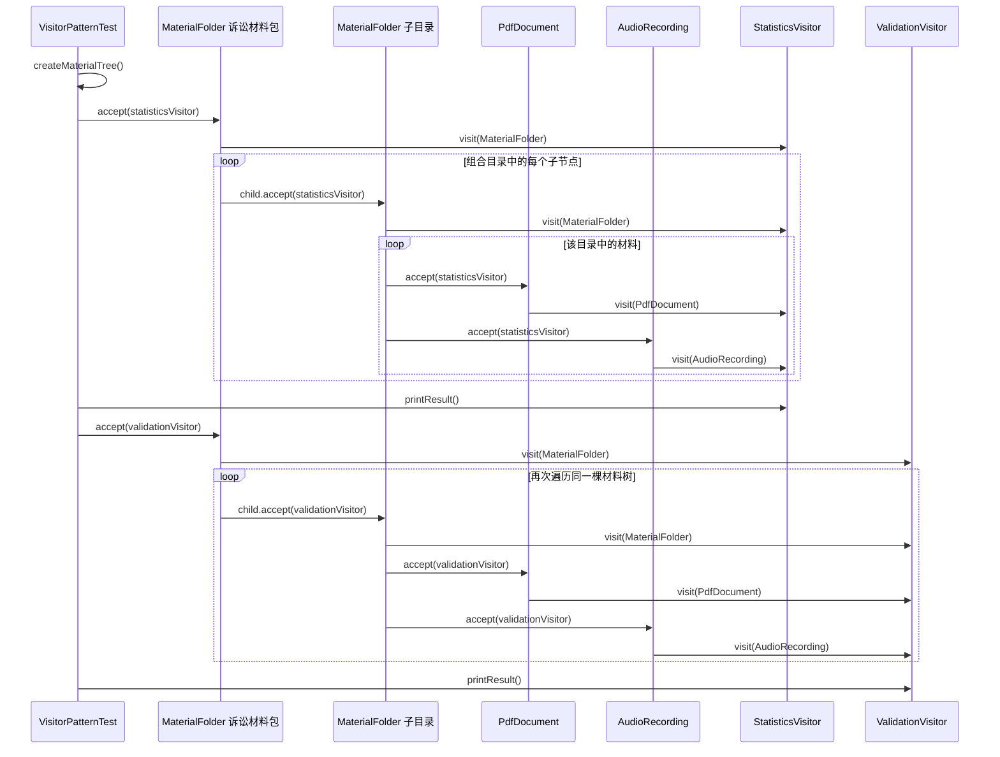

# v3-pattern：accept 与双重分派

## 代码流程图

```mermaid
flowchart TD
    A[VisitorPatternTest.shouldApplyDifferentVisitorsToTheSameMaterialTree] --> B[createMaterialTree]
    B --> C[root.accept statisticsVisitor]
    C --> D[MaterialFolder.accept]
    D --> E[StatisticsVisitor.visit(MaterialFolder)]
    D --> F{遍历 MaterialFolder.getChildren}
    F -->|目录| D
    F -->|PDF| G[PdfDocument.accept]
    F -->|录音| H[AudioRecording.accept]
    G --> I[StatisticsVisitor.visit(PdfDocument)]
    H --> J[StatisticsVisitor.visit(AudioRecording)]
    I --> K[StatisticsVisitor 累加统计结果]
    J --> K
    K --> L[StatisticsVisitor.printResult]
    L --> M[root.accept validationVisitor]
    M --> N[MaterialFolder.accept]
    N --> O[ValidationVisitor.visit(MaterialFolder)]
    N --> P{遍历 MaterialFolder.getChildren}
    P -->|目录| N
    P -->|PDF| Q[PdfDocument.accept]
    P -->|录音| R[AudioRecording.accept]
    Q --> S[ValidationVisitor.visit(PdfDocument)]
    R --> T[ValidationVisitor.visit(AudioRecording)]
    S --> U[ValidationVisitor.printResult]
    T --> U
```

## 代码时序图



## 阅读提示

- `MaterialNode.accept` 的第一次动态分派进入具体元素。
- `visitor.visit(this)` 的重载由 `this` 的编译期静态类型选择，随后按访问者运行时类型执行实现。
- 目录递归使用 JDK 集合迭代器；Visitor 不持有遍历位置，也不替代组合结构。
