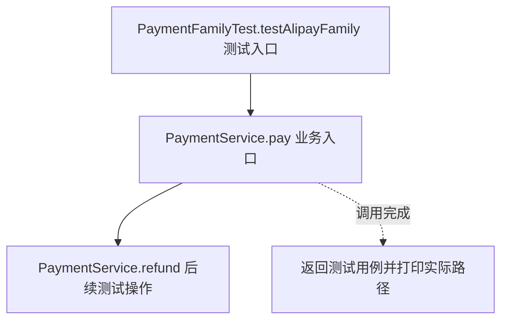
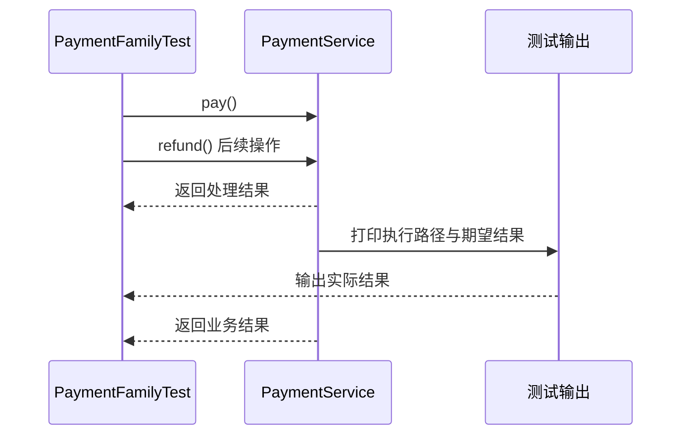

# 抽象工厂模式：v1-naive 流程图与时序图

本图对应版本说明：service/PaymentService；支付和退款各自分支并直接 new；服务依赖四个具体类。

## 代码流程图

## 代码时序图

## 阅读提示

- 先从 `PaymentFamilyTest.testAlipayFamily()` 进入，再沿图中的真实类名和方法名阅读源码。
- 本版本的模式关注点：抽象工厂按产品族创建相互匹配的一组产品。
- 条件分支与返回细节请结合图中方法源码和同目录测试用例观察。
