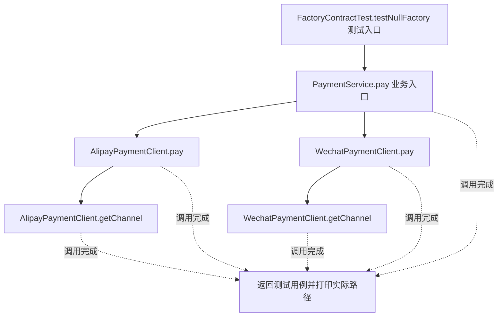
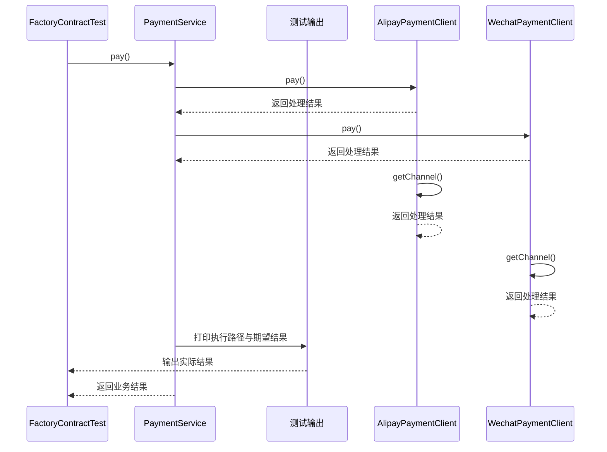

# 抽象工厂模式：v3-pattern 流程图与时序图

本图对应版本说明：factory/PaymentComponentFactory；一次选择产品族，一个工厂提供两类匹配产品。

## 代码流程图

## 代码时序图

## 阅读提示

- 先从 `FactoryContractTest.testNullFactory()` 进入，再沿图中的真实类名和方法名阅读源码。
- 本版本的模式关注点：抽象工厂按产品族创建相互匹配的一组产品。
- 条件分支与返回细节请结合图中方法源码和同目录测试用例观察。
