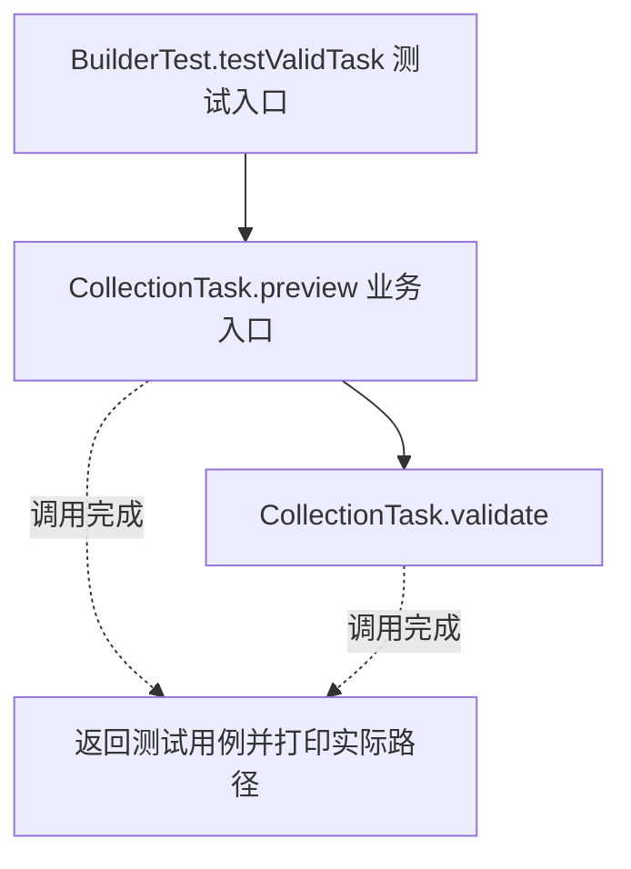
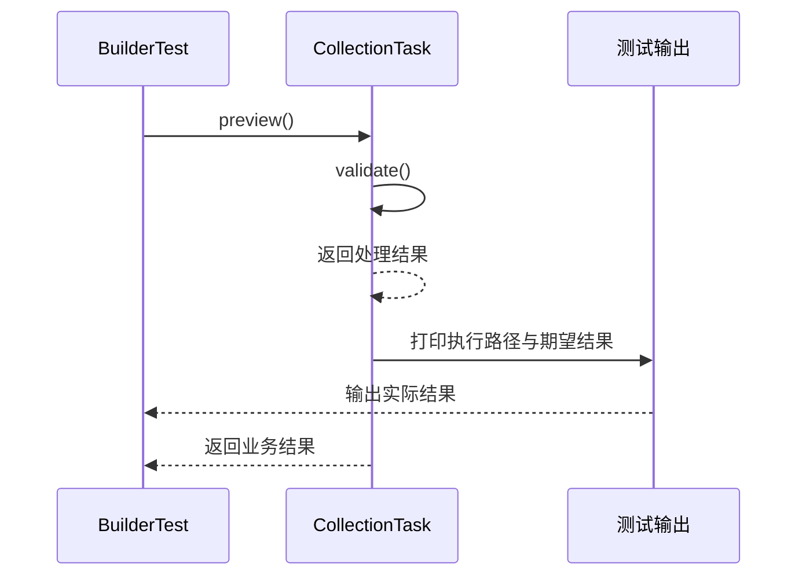

# 建造者模式：v1-naive 流程图与时序图

本图对应版本说明：七个位置参数的构造器；能校验合法性，但多个 int 参数容易弄错含义和顺序。

## 代码流程图

## 代码时序图

## 阅读提示

- 先从 `BuilderTest.testValidTask()` 进入，再沿图中的真实类名和方法名阅读源码。
- 本版本的模式关注点：建造者分步骤配置复杂对象，并在构建时统一校验和形成对象。
- 条件分支与返回细节请结合图中方法源码和同目录测试用例观察。
