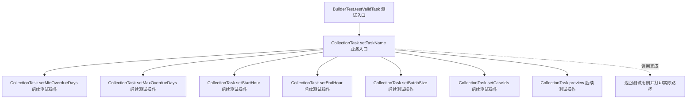
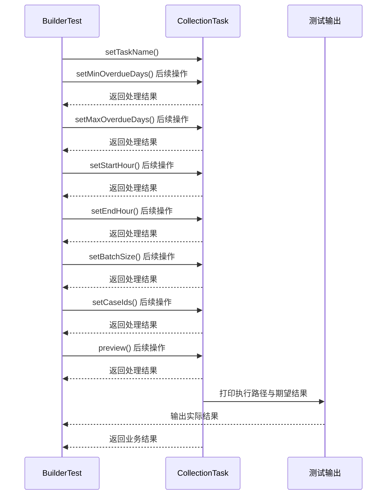

# 建造者模式：v2-refactor 流程图与时序图

本图对应版本说明：无参构造 + setter；含义直观，但对象可能暂时不完整，preview 才检查全部约束。

## 代码流程图

## 代码时序图

## 阅读提示

- 先从 `BuilderTest.testValidTask()` 进入，再沿图中的真实类名和方法名阅读源码。
- 本版本的模式关注点：建造者分步骤配置复杂对象，并在构建时统一校验和形成对象。
- 条件分支与返回细节请结合图中方法源码和同目录测试用例观察。
