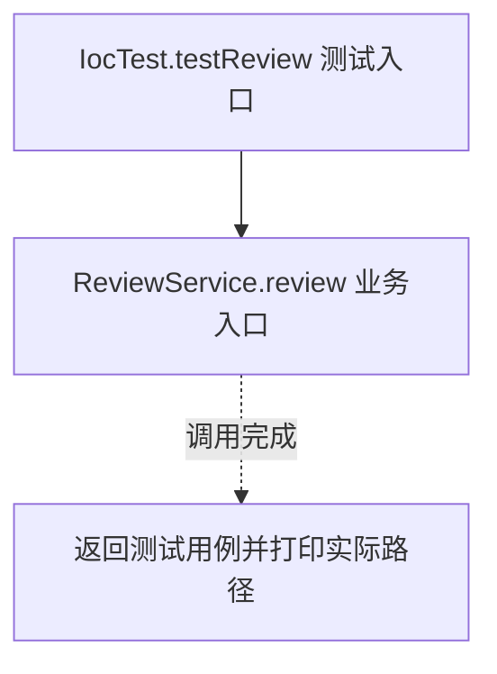
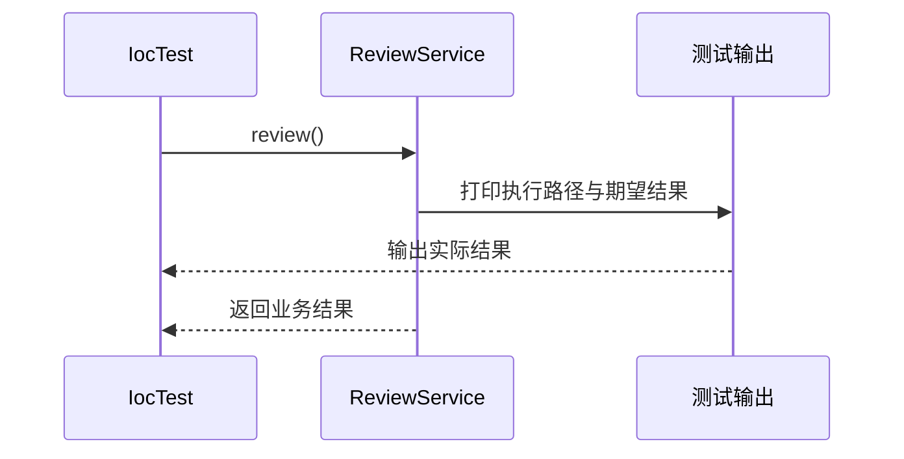

# 工厂与 IOC 容器：v1-naive 流程图与时序图

本图对应版本说明：ReviewService 注入 ApplicationContext 后主动 getBean；可运行的服务定位器反例：隐藏业务依赖。

## 代码流程图

## 代码时序图

## 阅读提示

- 先从 `IocTest.testReview()` 进入，再沿图中的真实类名和方法名阅读源码。
- 本版本的模式关注点：工厂与 IOC 示例关注对象创建、依赖注入及容器管理边界。
- 条件分支与返回细节请结合图中方法源码和同目录测试用例观察。
