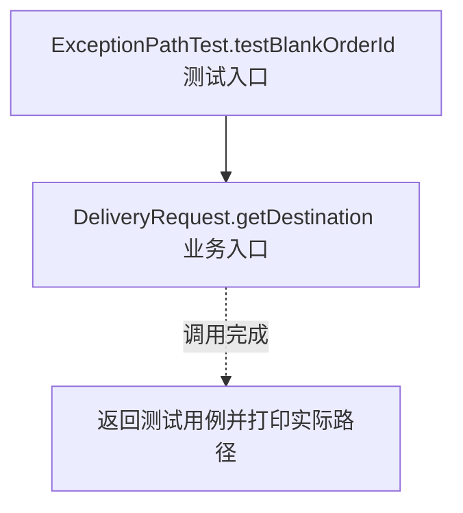
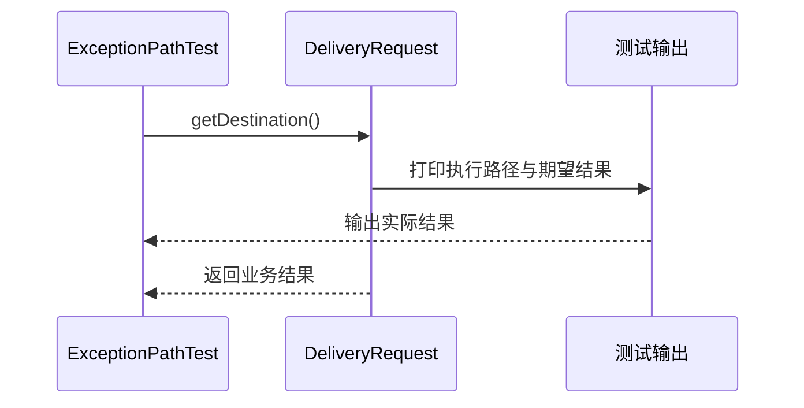

# 工厂方法模式：v3-pattern 流程图与时序图

本图对应版本说明：v3-pattern 版本的具体实现。

## 代码流程图

## 代码时序图

## 阅读提示

- 先从 `ExceptionPathTest.testBlankOrderId()` 进入，再沿图中的真实类名和方法名阅读源码。
- 本版本的模式关注点：工厂方法将产品创建延迟到创建者子类或可扩展的创建方法。
- 条件分支与返回细节请结合图中方法源码和同目录测试用例观察。
