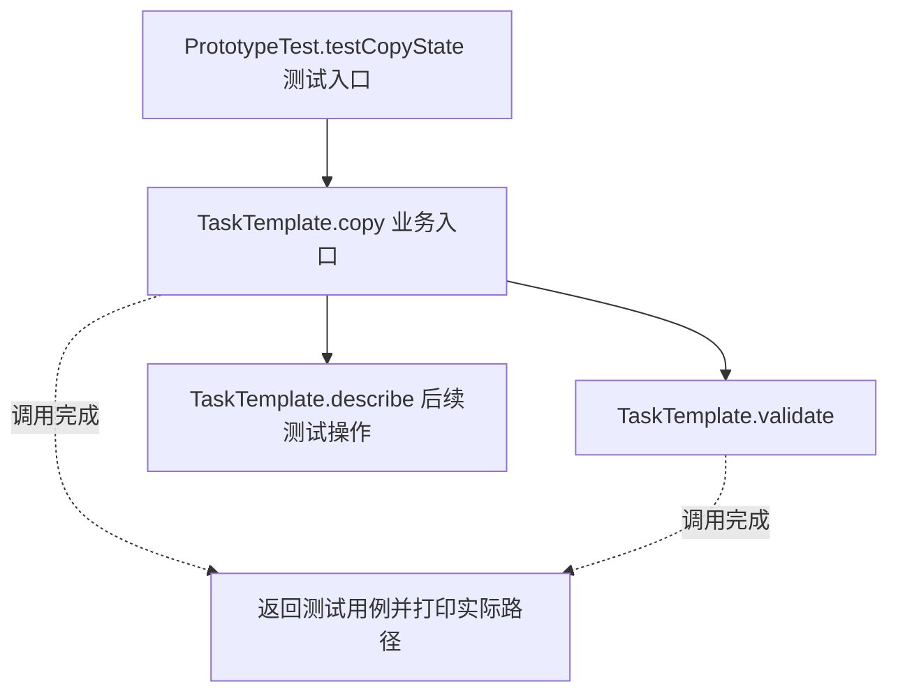
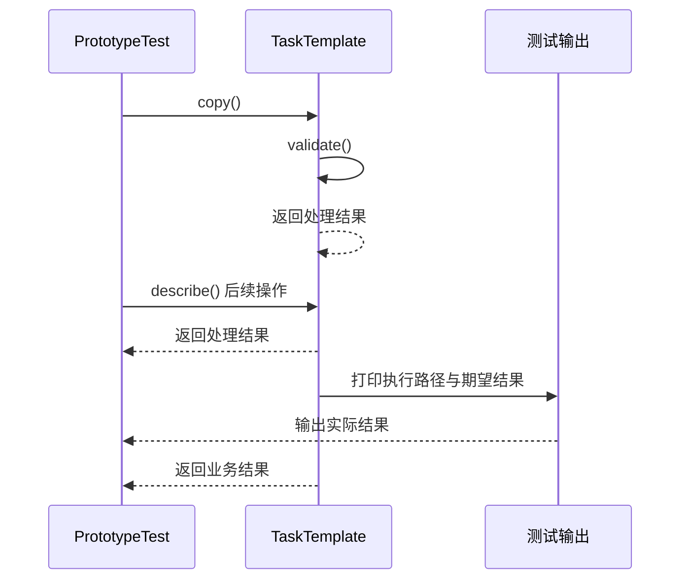

# 原型模式：v2-refactor 流程图与时序图

本图对应版本说明：Object.clone + new ArrayList；对象和列表不同，但可变 ReviewStep 仍相同。

## 代码流程图

## 代码时序图

## 阅读提示

- 先从 `PrototypeTest.testCopyState()` 进入，再沿图中的真实类名和方法名阅读源码。
- 本版本的模式关注点：原型通过复制已有对象创建新实例，并明确复制深度与可变状态边界。
- 条件分支与返回细节请结合图中方法源码和同目录测试用例观察。
