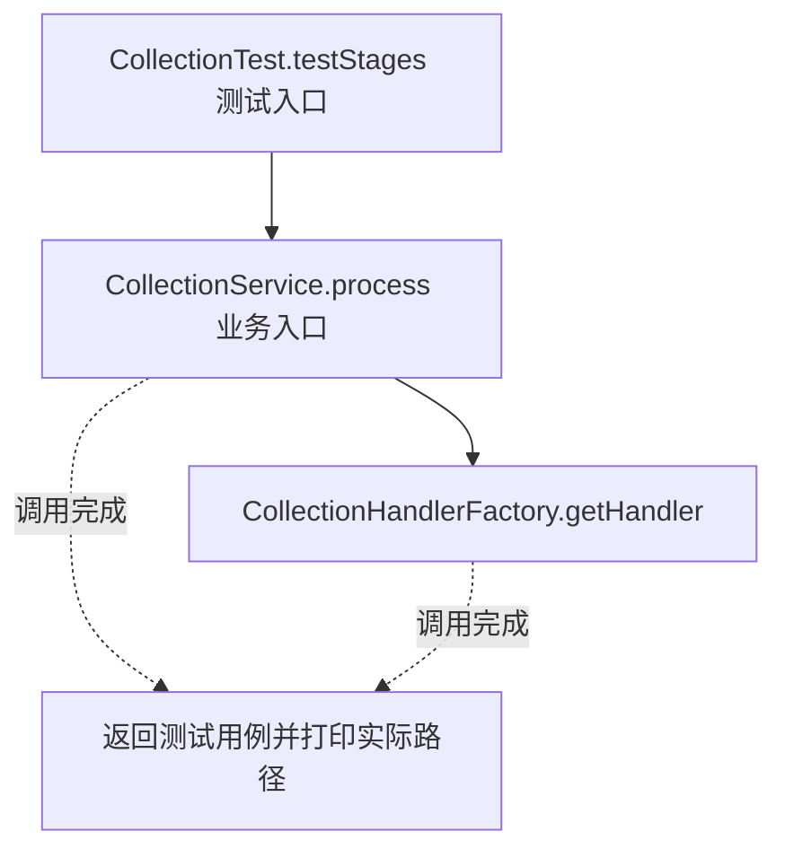
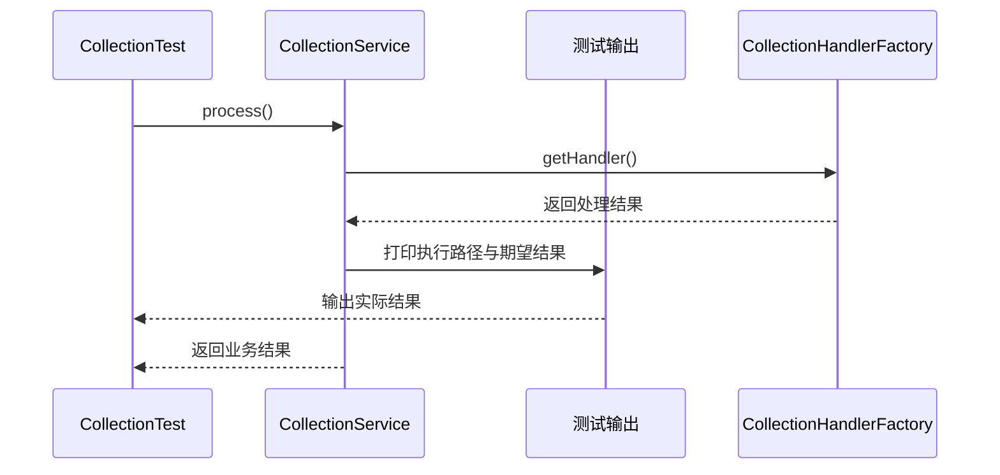

# 注册式工厂模式：v2-refactor 流程图与时序图

本图对应版本说明：CollectionHandlerFactory；显式注册两个实例，业务服务不再判断阶段，但工厂新增类型仍要修改。

## 代码流程图

## 代码时序图

## 阅读提示

- 先从 `CollectionTest.testStages()` 进入，再沿图中的真实类名和方法名阅读源码。
- 本版本的模式关注点：注册式工厂根据类型注册并查找处理器，分离对象装配与业务分派。
- 条件分支与返回细节请结合图中方法源码和同目录测试用例观察。
