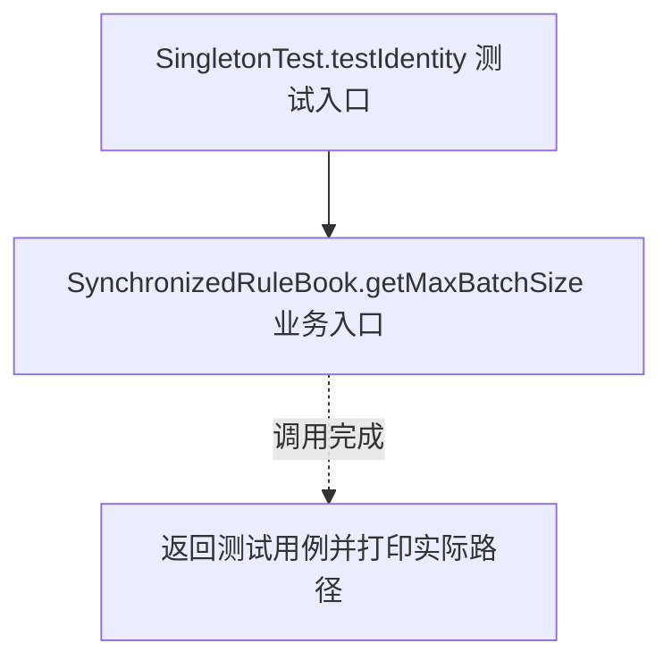
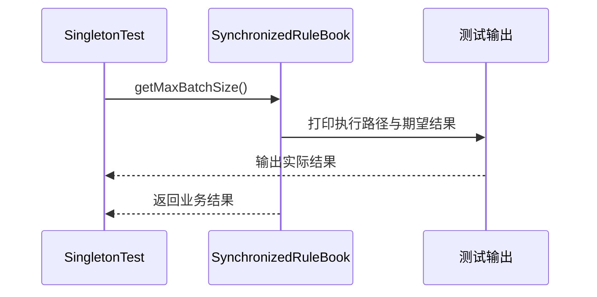

# 单例模式：v2-refactor 流程图与时序图

本图对应版本说明：synchronized 懒加载 SynchronizedRuleBook；锁保护初始化，移除案件共享状态；每次获取都加锁。

## 代码流程图

## 代码时序图

## 阅读提示

- 先从 `SingletonTest.testIdentity()` 进入，再沿图中的真实类名和方法名阅读源码。
- 本版本的模式关注点：单例实践比较实例创建与共享策略，并关注并发及共享状态边界。
- 条件分支与返回细节请结合图中方法源码和同目录测试用例观察。
