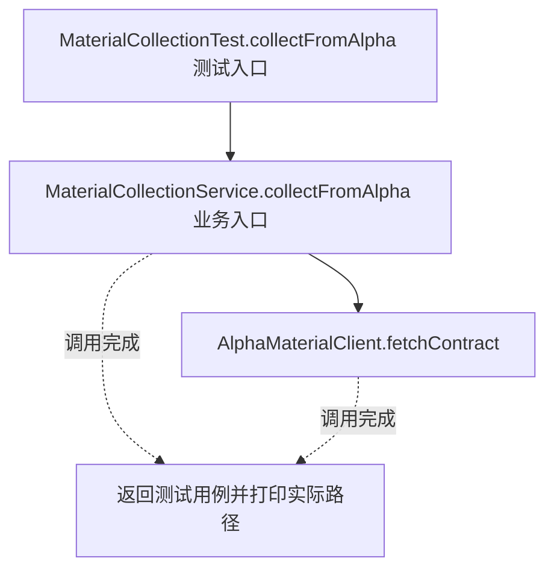
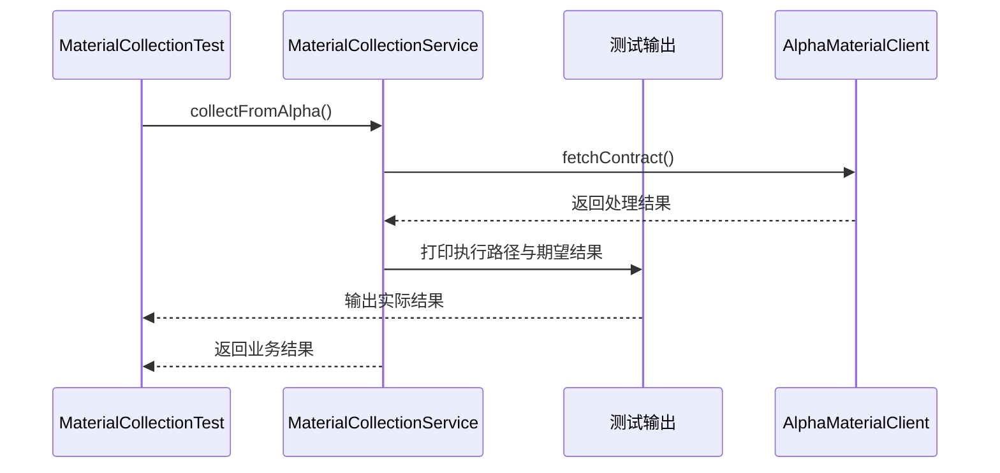

# 适配器模式：v1-naive 流程图与时序图

本图对应版本说明：归集服务直接调用两个 SDK 并转换；平台方法、参数和状态规则都侵入业务入口。

## 代码流程图

## 代码时序图

## 阅读提示

- 先从 `MaterialCollectionTest.collectFromAlpha()` 进入，再沿图中的真实类名和方法名阅读源码。
- 本版本的模式关注点：适配器把现有平台接口转换为业务所需的统一目标接口。
- 条件分支与返回细节请结合图中方法源码和同目录测试用例观察。
