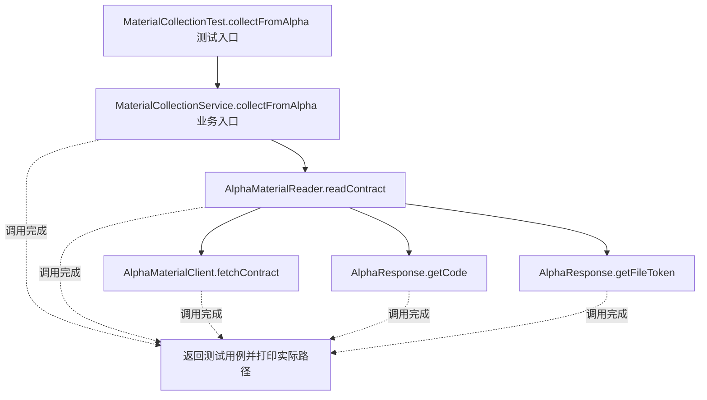
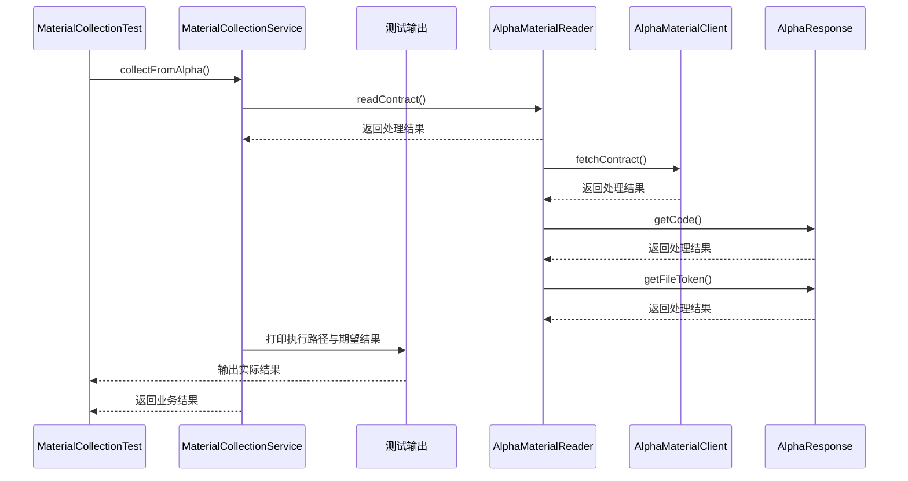

# 适配器模式：v2-refactor 流程图与时序图

本图对应版本说明：提取 AlphaMaterialReader、BetaMaterialReader；转换职责移走，但服务仍依赖两个具体类和不同调用方法。

## 代码流程图

## 代码时序图

## 阅读提示

- 先从 `MaterialCollectionTest.collectFromAlpha()` 进入，再沿图中的真实类名和方法名阅读源码。
- 本版本的模式关注点：适配器把现有平台接口转换为业务所需的统一目标接口。
- 条件分支与返回细节请结合图中方法源码和同目录测试用例观察。
