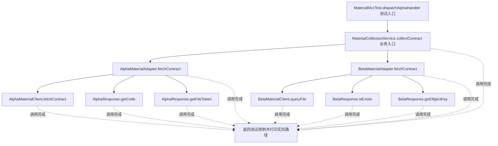
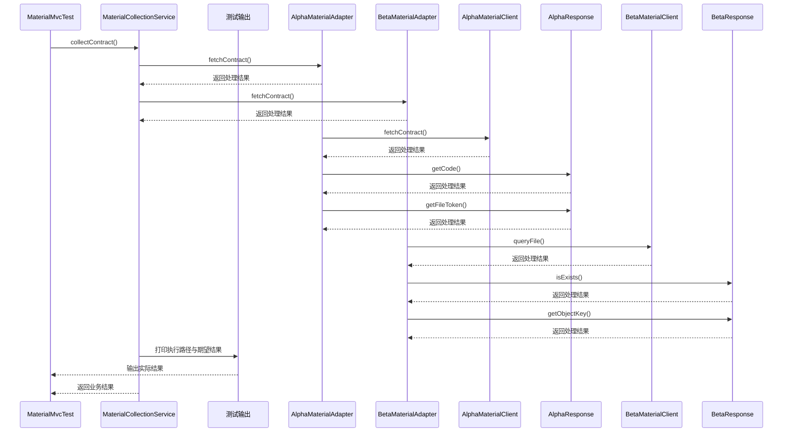

# 适配器模式：v4-spring-mvc 流程图与时序图

本图对应版本说明：Spring 注入业务适配器，MVC 调度不同处理器；同时观察业务适配和框架 HandlerAdapter 两种边界。

## 代码流程图

## 代码时序图

## 阅读提示

- 先从 `MaterialMvcTest.dispatchAlphaHandler()` 进入，再沿图中的真实类名和方法名阅读源码。
- 本版本的模式关注点：适配器把现有平台接口转换为业务所需的统一目标接口。
- 条件分支与返回细节请结合图中方法源码和同目录测试用例观察。
