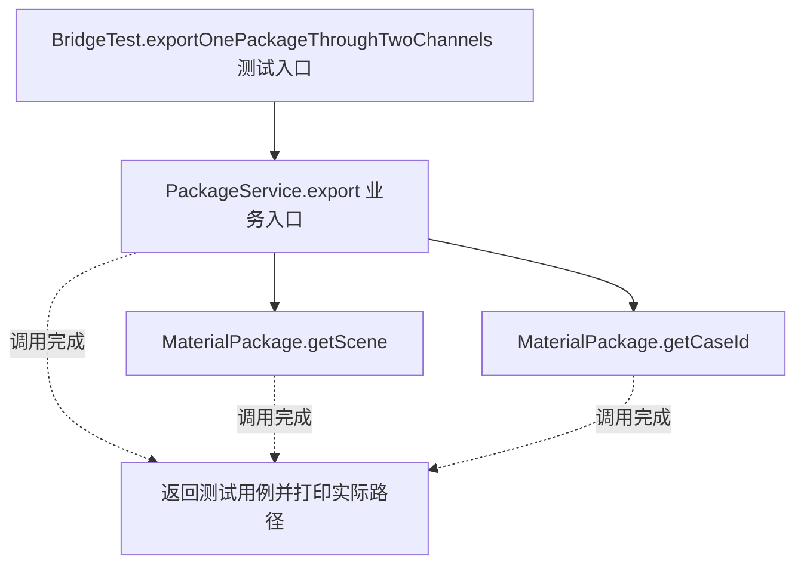
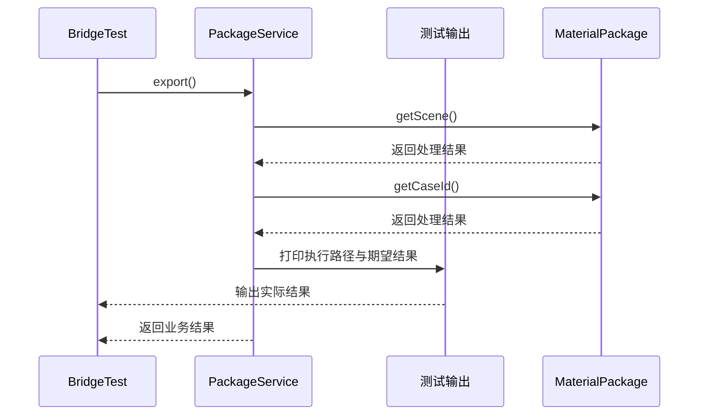

# 桥接模式：v1-naive 流程图与时序图

本图对应版本说明：PackageService` 根据渠道字符串选择渠道类；业务服务集中选择实现，调用方传字符串；新增材料包和渠道时分支增长。

## 代码流程图

## 代码时序图

## 阅读提示

- 先从 `BridgeTest.exportOnePackageThroughTwoChannels()` 进入，再沿图中的真实类名和方法名阅读源码。
- 本版本的模式关注点：桥接将业务抽象与输出实现分离，使两个变化维度可以独立扩展。
- 条件分支与返回细节请结合图中方法源码和同目录测试用例观察。
