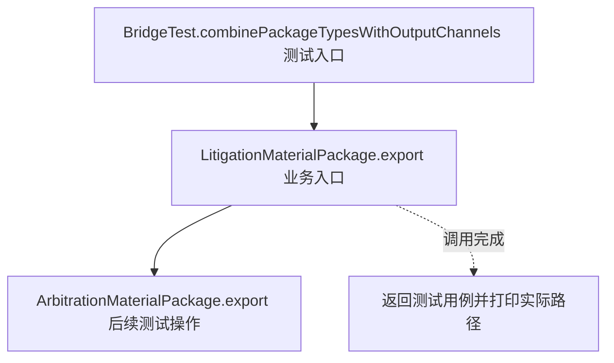
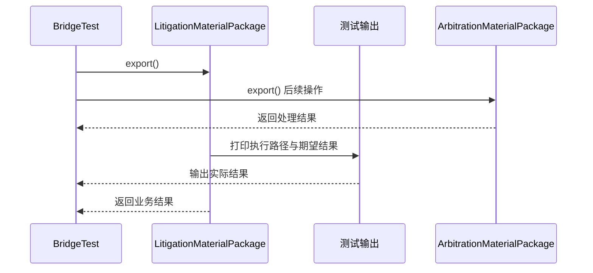

# 桥接模式：v3-pattern 流程图与时序图

本图对应版本说明：材料包抽象持有 `OutputChannel` 接口；诉讼、仲裁和各渠道分别实现自己的职责；两个维度可以独立扩展和组合。

## 代码流程图

## 代码时序图

## 阅读提示

- 先从 `BridgeTest.combinePackageTypesWithOutputChannels()` 进入，再沿图中的真实类名和方法名阅读源码。
- 本版本的模式关注点：桥接将业务抽象与输出实现分离，使两个变化维度可以独立扩展。
- 条件分支与返回细节请结合图中方法源码和同目录测试用例观察。
