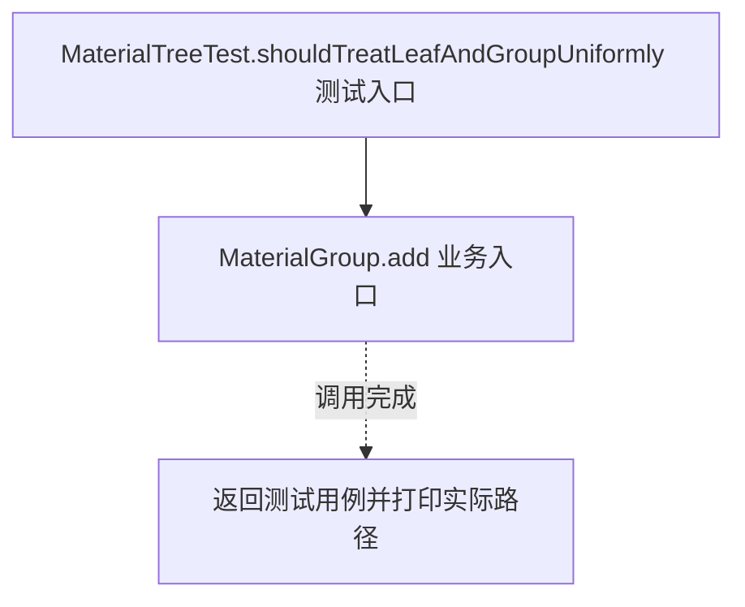
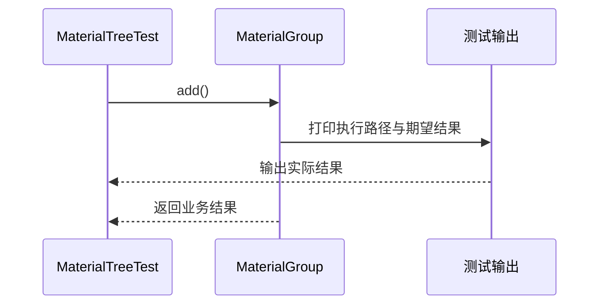

# 组合模式：v3-pattern 流程图与时序图

本图对应版本说明：MaterialNode 统一抽象，材料是叶子，目录是组合对象；客户端以相同方法处理叶子和任意层级目录。

## 代码流程图

## 代码时序图

## 阅读提示

- 先从 `MaterialTreeTest.shouldTreatLeafAndGroupUniformly()` 进入，再沿图中的真实类名和方法名阅读源码。
- 本版本的模式关注点：组合以统一接口表示叶子与容器，使客户端一致处理树形结构。
- 条件分支与返回细节请结合图中方法源码和同目录测试用例观察。
