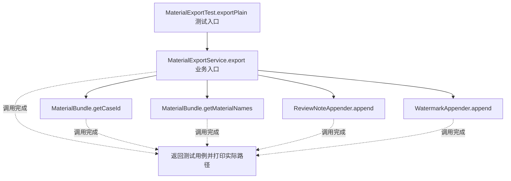
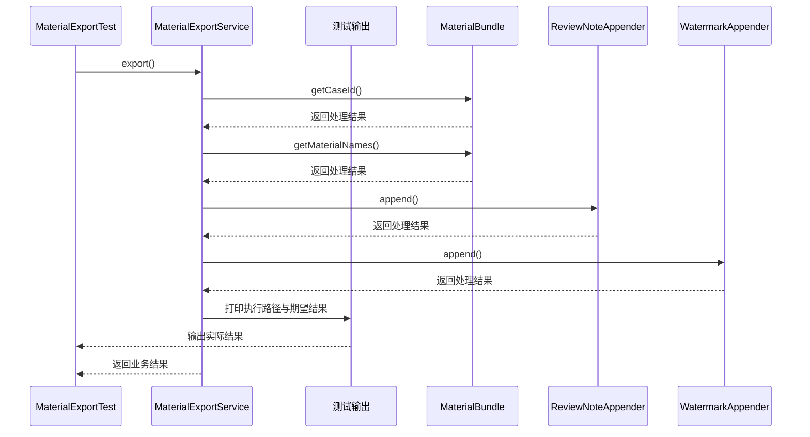

# 装饰器模式：v2-refactor 流程图与时序图

本图对应版本说明：拆出 ReviewNoteAppender、WatermarkAppender；职责清楚了，但服务仍控制分支和顺序；还不是装饰器。

## 代码流程图

## 代码时序图

## 阅读提示

- 先从 `MaterialExportTest.exportPlain()` 进入，再沿图中的真实类名和方法名阅读源码。
- 本版本的模式关注点：装饰器通过同接口包装组件，在不改变原组件类的情况下叠加职责。
- 条件分支与返回细节请结合图中方法源码和同目录测试用例观察。
