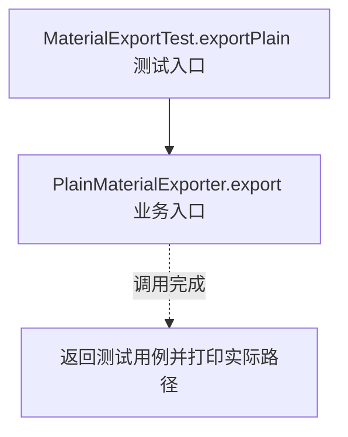
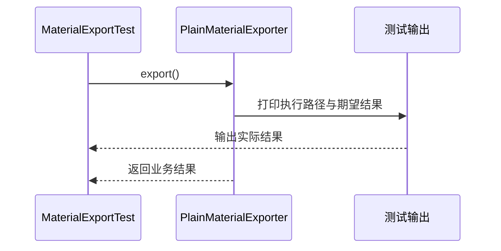

# 装饰器模式：v3-pattern 流程图与时序图

本图对应版本说明：同接口组件逐层包装；基础组件不变，调用方通过组合选择增强与顺序。

## 代码流程图

## 代码时序图

## 阅读提示

- 先从 `MaterialExportTest.exportPlain()` 进入，再沿图中的真实类名和方法名阅读源码。
- 本版本的模式关注点：装饰器通过同接口包装组件，在不改变原组件类的情况下叠加职责。
- 条件分支与返回细节请结合图中方法源码和同目录测试用例观察。
