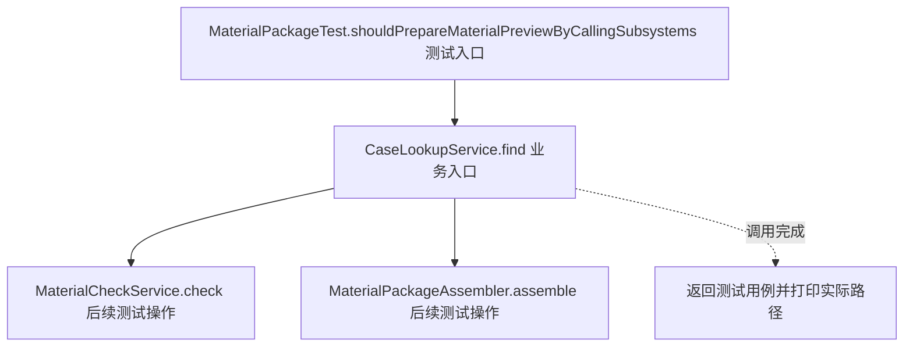
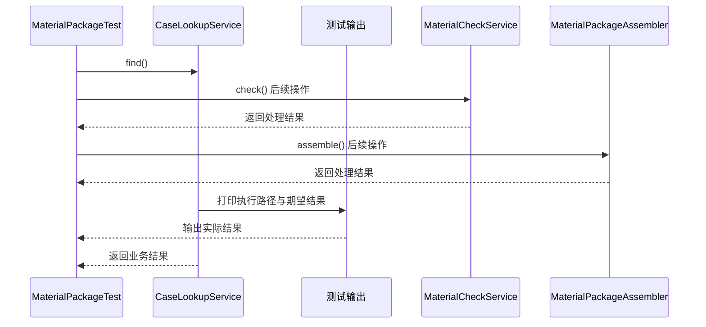

# 外观模式：v1-naive 流程图与时序图

本图对应版本说明：测试客户端依次调用四个子系统；调用方必须掌握完整步骤和顺序。

## 代码流程图

## 代码时序图

## 阅读提示

- 先从 `MaterialPackageTest.shouldPrepareMaterialPreviewByCallingSubsystems()` 进入，再沿图中的真实类名和方法名阅读源码。
- 本版本的模式关注点：外观为多个子系统提供统一的业务入口并封装调用顺序。
- 条件分支与返回细节请结合图中方法源码和同目录测试用例观察。
