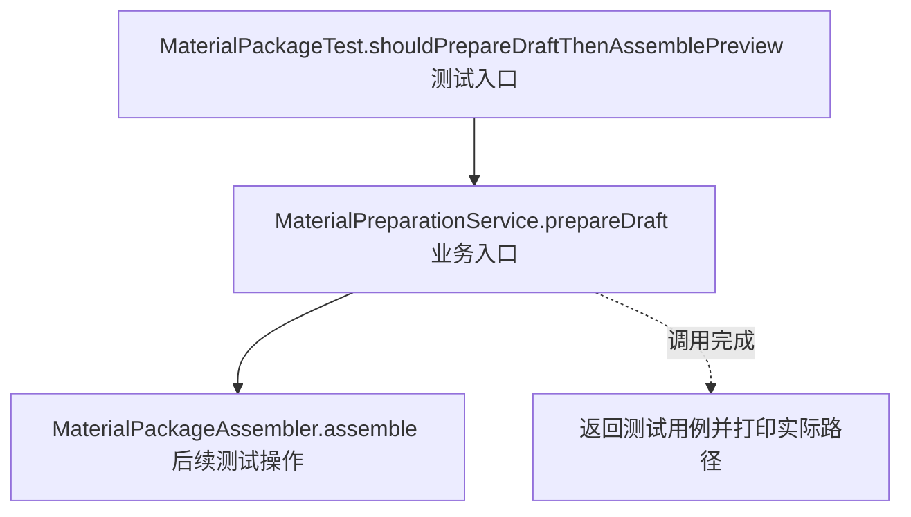
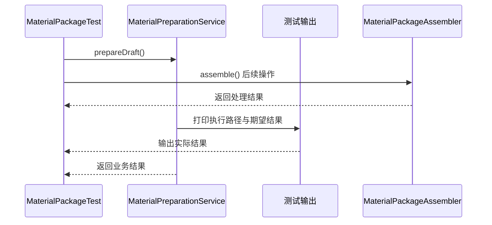

# 外观模式：v2-refactor 流程图与时序图

本图对应版本说明：工作流服务整理准备步骤，调用方再调用组装器；部分流程已集中，但调用方仍知道中间结果和下一步骤。

## 代码流程图

## 代码时序图

## 阅读提示

- 先从 `MaterialPackageTest.shouldPrepareDraftThenAssemblePreview()` 进入，再沿图中的真实类名和方法名阅读源码。
- 本版本的模式关注点：外观为多个子系统提供统一的业务入口并封装调用顺序。
- 条件分支与返回细节请结合图中方法源码和同目录测试用例观察。
