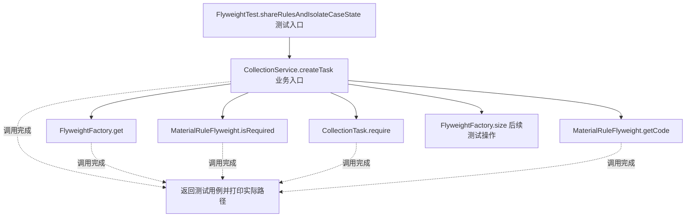
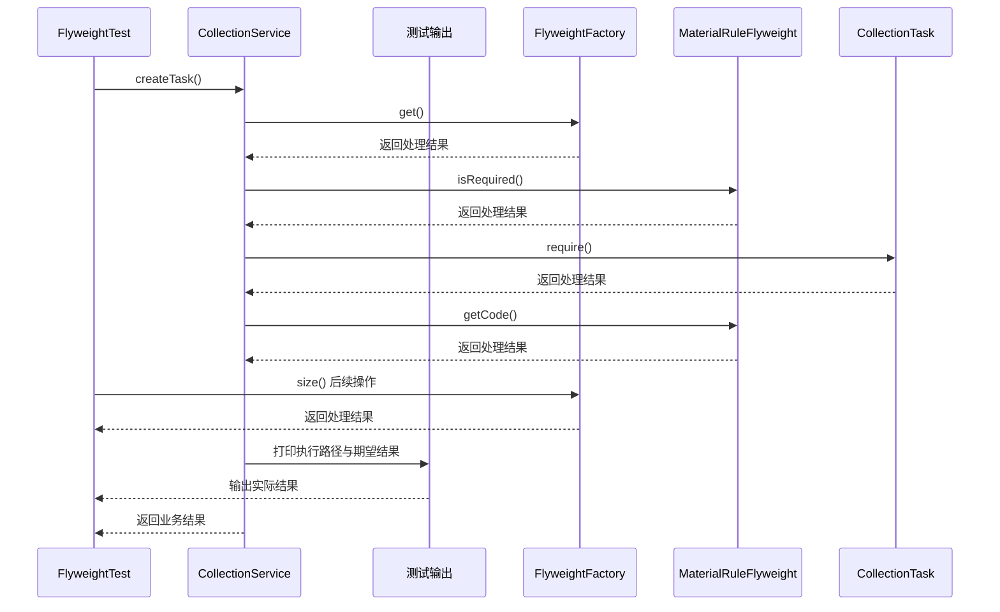

# 享元模式：v3-pattern 流程图与时序图

本图对应版本说明：FlyweightFactory` 按规则键缓存不可变规则；3。

## 代码流程图

## 代码时序图

## 阅读提示

- 先从 `FlyweightTest.shareRulesAndIsolateCaseState()` 进入，再沿图中的真实类名和方法名阅读源码。
- 本版本的模式关注点：享元复用可共享的不可变内在状态，并把案件等外部状态留在使用者对象。
- 条件分支与返回细节请结合图中方法源码和同目录测试用例观察。
