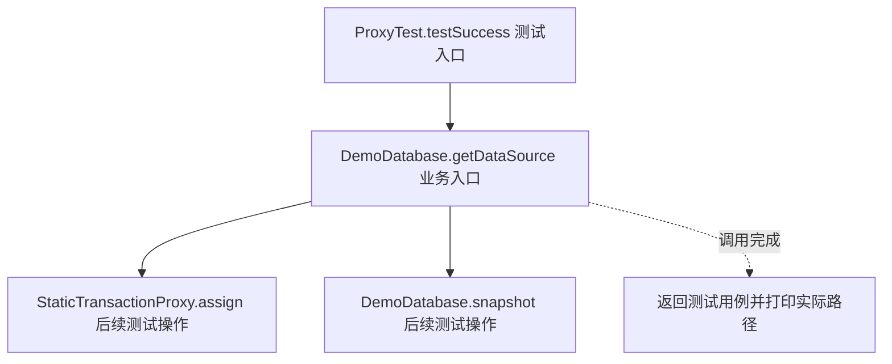
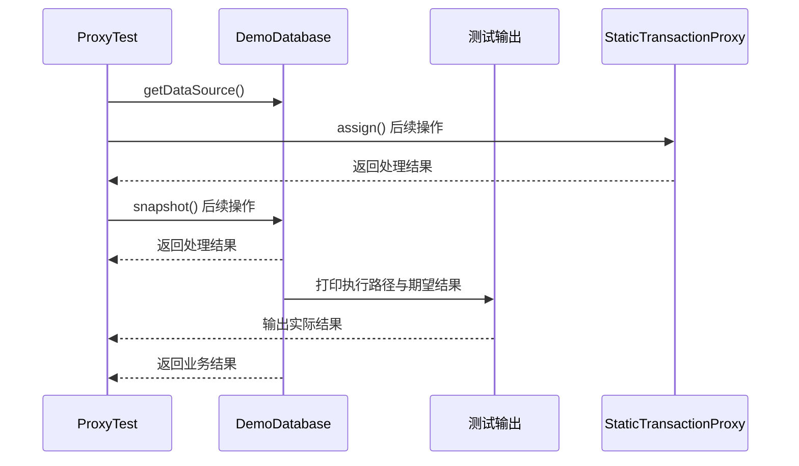

# 代理模式：v2-refactor 流程图与时序图

本图对应版本说明：StaticTransactionProxy；手工实现同一接口，在目标调用前后包事务。

## 代码流程图

## 代码时序图

## 阅读提示

- 先从 `ProxyTest.testSuccess()` 进入，再沿图中的真实类名和方法名阅读源码。
- 本版本的模式关注点：代理在客户端与目标对象之间控制访问，并可承载事务等横切边界。
- 条件分支与返回细节请结合图中方法源码和同目录测试用例观察。
