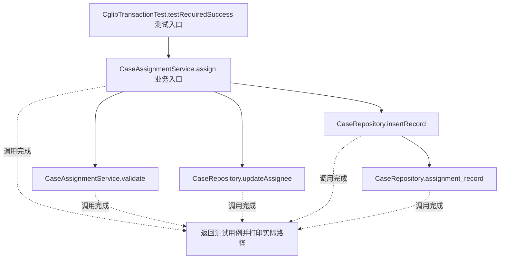
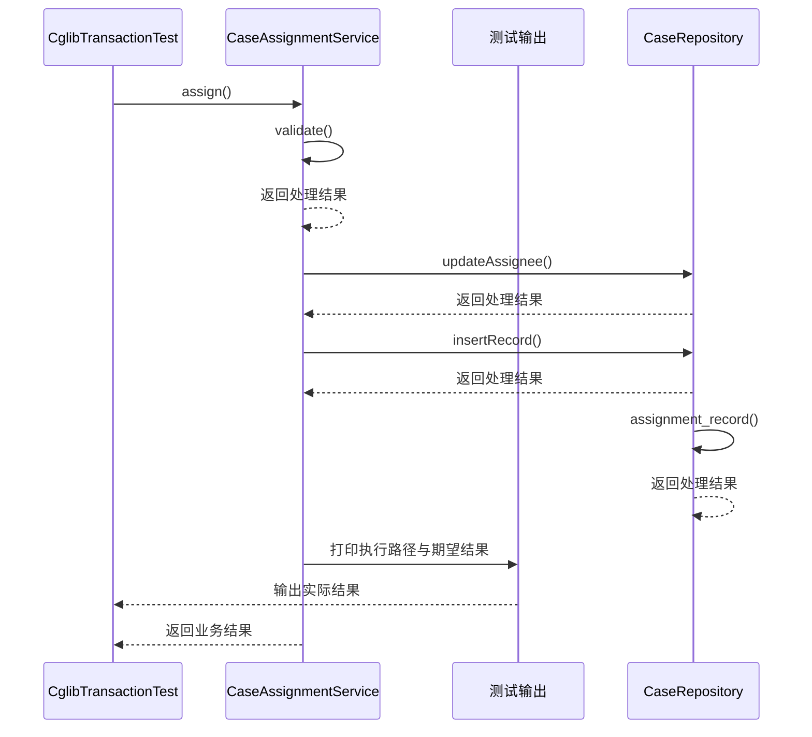

# 代理模式：v4-spring 流程图与时序图

本图对应版本说明：JdkTransactionConfig、CglibTransactionConfig；真实 @Transactional，分别强制接口代理与类代理。

## 代码流程图

## 代码时序图

## 阅读提示

- 先从 `CglibTransactionTest.testRequiredSuccess()` 进入，再沿图中的真实类名和方法名阅读源码。
- 本版本的模式关注点：代理在客户端与目标对象之间控制访问，并可承载事务等横切边界。
- 条件分支与返回细节请结合图中方法源码和同目录测试用例观察。
