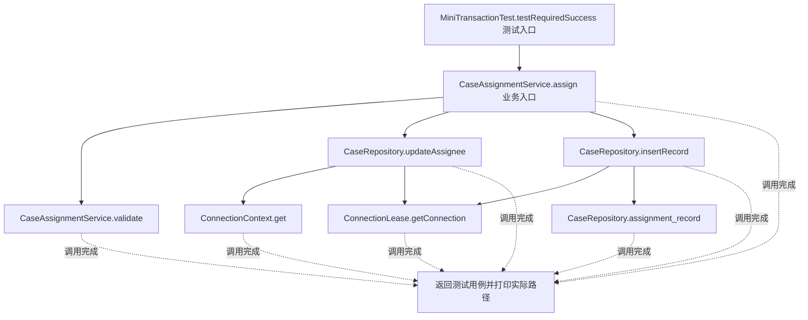
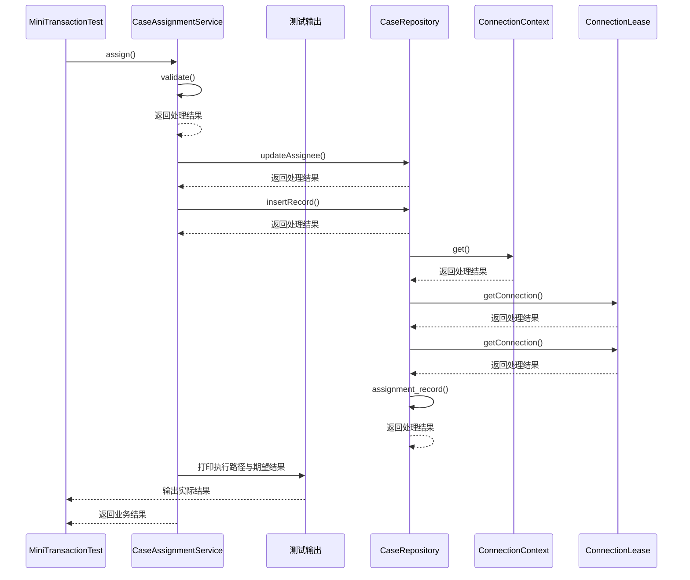

# 代理模式：v5-mini-framework 流程图与时序图

本图对应版本说明：MiniTransactionAutoProxyCreator；自定义注解 + Spring 后处理器 + JDK 代理 + 自制事务管理器。

## 代码流程图

## 代码时序图

## 阅读提示

- 先从 `MiniTransactionTest.testRequiredSuccess()` 进入，再沿图中的真实类名和方法名阅读源码。
- 本版本的模式关注点：代理在客户端与目标对象之间控制访问，并可承载事务等横切边界。
- 条件分支与返回细节请结合图中方法源码和同目录测试用例观察。
